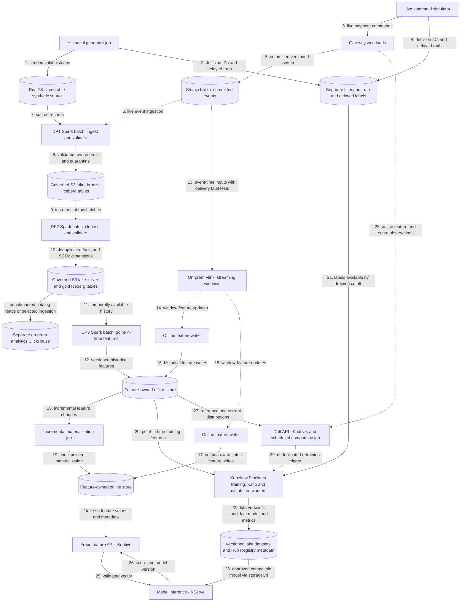

# Data and ML flows

Planned generators, DP1–DP3 pipelines, feature stores, training and drift monitoring. Deployable units and the deployment view are in the [architecture overview](payment-gateway.md); payment contracts are in [payment flows](payment-flows.md). Capability coverage and required proof are tracked in the [roadmap](roadmap.md).

## Flow

This is a target flow, not a claim that its data engines, catalog or warehouse are deployed. Solid arrows show batch/storage transfers and synchronous reads; dotted arrows show streaming events or asynchronous triggers. Storage nodes are labelled by role; feature-access libraries are embedded in jobs/APIs rather than depicted as deployable services.

## Generation

The [historical payments data product](../data-products/historical-payments.md) supplies valid lifecycle histories outside bronze and outside production payment event storage. The finite production source run and authenticated sanity Notebook are recorded in [historical source verification](../verification/historical-data.md). Live simulation calls gateway commands so Payments creates authoritative events. Both modes share versioned scenarios for customer, seller, device and synthetic method profiles: ordinary purchases, stolen-card/new-device behavior, unusual geography, reshipping, card testing and retry attacks. Burst, lateness and duplicate delivery are transport conditions; they never fabricate duplicate authoritative transitions. The dev live simulator and fault injector remain long-running Deployments using the shared source identity, not notebook sessions, KFP runs or indefinite workflows.

## Pipelines and schemas

The [historical payments data product](../data-products/historical-payments.md) describes the source interface, agreement and validation workflow. Curated dataset contracts are added with their pipelines.

DP1 ingests and validates raw records; DP2 cleanses and curates them; DP3 computes historical features. Each has observable ingest/validate stages, reusable centrally managed connections/configuration, quarantine or failed-validation evidence, and source/table/job lineage. Bronze uses `raw_`, silver `stg_`, and gold `dim_`, `fact_`, `obt_`, `feat_` conventions. SCD2 dimensions carry `valid_from_ts`, `valid_to_ts`, `is_current`; feature tables carry `event_timestamp` and `created`.

Argo Workflows coordinates finite on-prem Spark batch stages and their retries; a Spark-on-Kubernetes operator is a candidate only if it improves lifecycle management over native Spark jobs. Evaluate RustFS's preview built-in S3 Tables/Iceberg REST catalog for multi-engine snapshots on a dedicated governed lake table bucket; retain a separate catalog as a fallback until the deployed RustFS version, Spark/Flink interoperability, commit safety, snapshot recovery and operator-run maintenance are proven. The `synthetic-source` bucket remains immutable Parquet input, not an Iceberg table: DP1 ingests it into separate Bronze tables, and DP2/DP3 publish curated snapshots. Compaction, snapshot expiration, orphan cleanup and retention are explicit maintenance work. A separately owned analytical ClickHouse deployment evaluates catalog-backed reads against ingesting selected data into local analytical tables; the existing ClickStack telemetry store is not reused as a warehouse. See [analytics foundation #71](https://github.com/phuchoang2603/realtime-credit-card-fraud-detection/issues/71).

Streaming windows specify event time, watermarks, allowed lateness, deduplication and restart semantics. Offline and online writers are independently observable. Incremental materialization has checkpoints, retries and version-aware idempotency; older late writes cannot replace newer online state. Per-feature TTL, stale/missing defaults and feature-version compatibility protect serving.

Long-running Flink jobs and their checkpoints stay on premises near Kafka and the lake. Local Spark is the batch baseline. [AWS burst evaluation #72](https://github.com/phuchoang2603/realtime-credit-card-fraud-detection/issues/72) may stage an immutable versioned snapshot *one way* from MinIO to AWS S3 for a bounded Spark backfill; cloud outputs stay in separate S3 storage until validated and selectively imported. No live bidirectional Iceberg/catalog replication, cross-WAN Flink state or unmeasured large Spark deployment on today's stateless AWS workers.

## Training and drift

Training grain is one scored attempt/decision, not one payment event. Joins use scoped identity plus decision/attempt IDs; labels remain separate with `label_available_at`. Features use only information available at decision time, including ingestion/availability timestamps when events arrive late. Future outcomes, fraud truth and the decision itself must not leak into its features. Temporal evaluation splits, cold starts and late-label cases require explicit proof.

Training extends the accepted [mini baseline (#67)](https://github.com/phuchoang2603/realtime-credit-card-fraud-detection/issues/67): [notebook acceptance (#53)](https://github.com/phuchoang2603/realtime-credit-card-fraud-detection/issues/53) requires that baseline, although exploration can overlap. Distributed training, incremental dataset storage, model registration and approved-model rollout to KServe ([#70](https://github.com/phuchoang2603/realtime-credit-card-fraud-detection/issues/70)) add capabilities without replacing mini generators, pipelines, windows or evidence. Drift compares versioned distributions without assuming immediate labels; retraining is deduplicated and cooldown-controlled, and promotion remains separately gated. See the [handoff checklist](roadmap.md#mini-to-final-handoff).

The prod-only Kubeflow Profile has GitOps configuration, not verified end-to-end ML workloads. Notebook v1 explores a fixed baseline (#53); Kubeflow Pipelines coordinates the same training/evaluation stages (#54) through the shared Argo controller, with bounded Katib trials and Trainer for suitable multi-worker algorithms. DP1–DP3 retain direct Argo Workflows definitions and can use the shared Spark Operator when justified. KFP artifacts and logs use a separate RustFS bucket; curated Iceberg snapshots are the versioned training data. KFP's pinned Kubernetes-native build has no ML Metadata service, so persist explicit dataset snapshot, label cutoff, feature contract, source/image, Katib trial and pipeline run references with each candidate. The Profile's Hub Registry indexes immutable model artifacts and approved versions (#55); KServe loads the approved URI and format (#56, #70), with promotion and rollback gated independently (#61). The shared platform owns Kubeflow controllers, ingress and identity, while this repo owns the notebook, pipeline, registry client and serving contracts. The later [fraud investigation agent (#74)](https://github.com/phuchoang2603/realtime-credit-card-fraud-detection/issues/74) reads recorded payment and fraud evidence; it never sits in the payment decision path.
