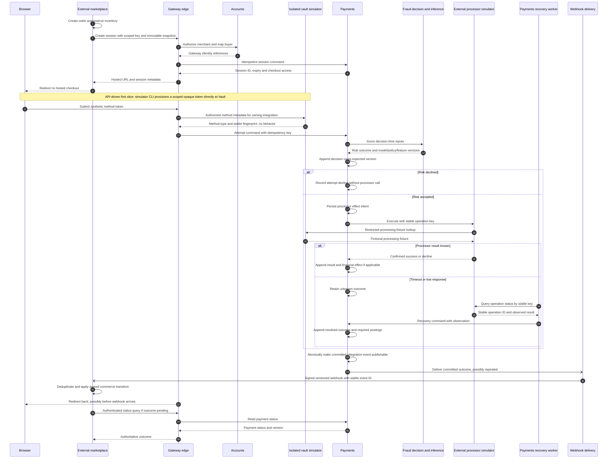

# Payment flows

Identity, checkout and payment-authority contracts for the planned gateway, with the checkout and recovery sequence. Deployable units and the deployment view are in the [architecture overview](payment-gateway.md); data and training flows are in [data and ML flows](data-ml-flows.md).

## Identity and checkout contract

One authenticated marketplace integration manages separate gateway merchant accounts for its sellers. Accounts maps `(integration_id, external_seller_id)` to `merchant_id` and `(integration_id, external_buyer_id)` to `customer_id`. Derive integration identity from credentials, not caller-selected tenant fields or email. Authorize seller provisioning explicitly and make it idempotent; buyer mapping may be lazy.

Buyer authentication remains at marketplace. Gateway checkout uses short-lived, scoped access without gateway buyer passwords or shared marketplace JWT secrets. Merchant records do not imply wallets, payouts or bank accounts. Credential rotation, revocation, disabled-account handling and tenant isolation belong to [PG-03 (#31)](https://github.com/phuchoang2603/realtime-credit-card-fraud-detection/issues/31) and [Accounts (#34)](https://github.com/phuchoang2603/realtime-credit-card-fraud-detection/issues/34).

Keep order, session, payment and attempt identifiers distinct. Scope external order references to the integration and merchant. Session creation is idempotent for the agreed order scope; a changed payload under an existing key is a conflict. Refreshing hosted checkout creates no new attempt. Amount/currency and commerce snapshots are immutable for that session; return URLs are validated. Signed webhook delivery and authenticated status queries determine commerce outcomes, never the buyer redirect alone.

The marketplace's [current webhook handler](https://github.com/phuchoang2603/refurbished-marketplace/blob/main/services/payment/internal/service/gateway_webhook.go) treats failed sessions as terminal and suppresses subsequent terminal outcomes. Target retries under the same order therefore require a contract change: [PG-04 (#32)](https://github.com/phuchoang2603/realtime-credit-card-fraud-detection/issues/32) must separate attempt decline from final payment failure, specify expiry/late-success handling, and coordinate inventory behavior with marketplace.

## Isolated synthetic vault

An authenticated simulator CLI sends an allow-listed fictional card reference and behavior to the separately deployed vault over encrypted gRPC. The vault creates an opaque random token bound to an integration, stores only its digest alongside an encrypted fixture payload in its own database, and returns the token once. This first slice accepts fixture references, not PAN, PIN or card-security-code fields. A later browser collection flow needs its own vault-facing access contract.

At attempt submission, Edge authenticates checkout access and calls the vault's restricted metadata API with the resolved integration identity. The response contains only method type and a stable fingerprint, derived from the fixture's card identity with the shared synthetic fingerprint key. It excludes token behavior and fixture contents. Thus token rotation does not change the card fingerprint or break historical/live identity parity. Unknown, inactive or foreign tokens are rejected before starting an attempt.

Only the authenticated processor-simulator identity may resolve a token to its fictional processing fixture. Payments stores an encrypted opaque token in a private operation-request record, committed with the effect intent, so crash recovery can submit an operation that was never received. Clear that encrypted token when the terminal outcome commits. Payments records only the safe method fingerprint in its existing event contract and never reads the vault database. Token values and fixture payloads must not enter event history, Fraud inputs, Redis or analytics. Known operation-status recovery needs no new token resolution. The isolation models a PCI DSS-oriented boundary; it does not establish compliance.

## Payment authority and recovery

Payments owns an ordered event stream per aggregate. Commands validate authoritative aggregate state and append with an expected version; stale status projections cannot authorize money movement. Durable idempotency stores the request identity, content binding and result so concurrent retries cannot create additional effects. Status views and snapshots are rebuildable; schema versions, correlation IDs and causation IDs preserve interpretation.

Persist an external-effect intent before calling the processor and reuse a stable operation key on retries. A timeout means **unknown**, not declined: query the simulator by operation key before deciding whether another operation is safe. Record discovered results as new events. The project omits automated reconciliation and bank settlement files. A later synthetic ISO profile must define its supported query or reversal/advice; if it cannot safely resolve an operation, leave it pending for inspection instead of blindly resending. The gRPC simulator's idempotent `Sale` and `GetOperation` are not universal bank capabilities.

Record each risk outcome with model, policy and feature versions. Aggregate replay consumes the recorded outcome; it never reruns models, invokes processors or sends webhooks. Recovery workers resume unresolved intents explicitly; projection replay does not activate external effects. Publish integration events atomically with committed domain state through an outbox or equivalent commit-log boundary. Consumers deduplicate stable event identities; transport may be at least once. A broker alone is not the authoritative event store.

The chosen commit-log boundary is the Payments event table: append events, status and idempotency in one Postgres transaction; later WAL CDC publishes committed payloads to Kafka. A `bigserial` position identifies a row but does not establish commit order. Payments uses Redis only for immutable completed-attempt results, keyed by integration/session and a digest of the idempotency key, with a request digest and TTL. Authorize the request before reading the cache. Do not cache pending state, method tokens, checkout credentials or sensitive request bodies. Miss, eviction, malformed entries or outage fall back to durable database idempotency; cache population happens only after commit. A changed request under the same key remains a conflict. Redis does not grant permission to call the processor.

The [bank adapter](payment-gateway.md#bank-adapter-and-iso-8583) translates gateway operations to a selected ISO 8583 or HTTP provider profile. Keep wire encoding, network/session management and bank-specific identifiers out of the domain aggregate. Fraud approval permits proceeding; issuer authentication verifies a separate concern, authorization can reserve funds, capture confirms a financial operation and settlement is established through provider evidence. The minimum synthetic `Sale` path does not implement all these stages.

Financial postings are distinct from domain workflow events and integration messages. The Payments-owned journal records balanced confirmed effects per currency in integer minor units; authorization holds differ from captured funds. Source event identity prevents duplicate postings. Refunds cannot cumulatively exceed captured funds, and corrections use compensating postings/events rather than edited history. The transactional/projection boundary belongs to [journal work (#36)](https://github.com/phuchoang2603/realtime-credit-card-fraud-detection/issues/36).

Event schemas and transition catalogs belong to [PG-05 (#33)](https://github.com/phuchoang2603/realtime-credit-card-fraud-detection/issues/33); implementation follows in [event storage (#35)](https://github.com/phuchoang2603/realtime-credit-card-fraud-detection/issues/35), [processor recovery (#38)](https://github.com/phuchoang2603/realtime-credit-card-fraud-detection/issues/38) and [refunds (#58)](https://github.com/phuchoang2603/realtime-credit-card-fraud-detection/issues/58).

## Checkout and recovery sequence

Solid closed arrows are requests, dotted closed arrows are responses, and open arrows are asynchronous delivery. Alternatives show different outcomes of the same operation.

Worker crashes, callback races and late results must converge on the same recorded effect. Webhook outages cause bounded retries with exponential backoff, jitter and observable delivery state. Provider retries also need per-provider budgets and rate limits; backoff alone does not make repeating a financial request safe. An unresolved payment stays pending for recovery; the browser returning does not prove payment success. The retry/expiry contract above must be agreed before marketplace releases inventory on failure.

## Later database sharding

Start with one Payments database. When measured capacity requires sharding, route `(integration_id, merchant_id)` through a durable, versioned shard directory. A payment has one authoritative home shard at a time and moves only through a fenced migration; use a stable locator for session/payment lookups rather than guessing a shard from caller-provided tenant fields. Events, idempotency rows, status, encrypted operation requests and the later journal share that home shard, preserving local atomic commits. Keep Accounts and vault ownership separate from Payments sharding.

Before moving an existing merchant, drain or fence its writers/recovery workers, copy and verify its complete state, switch the directory atomically and reject writes to the old owner. Define rollback and hot-merchant handling; do not add blind dual writes. CDC checkpoints become per shard, while stable event IDs and per-payment versions survive moves. Global sequence positions are shard-local; there is no cross-shard total commit order. Cross-merchant reporting consumes events asynchronously, not cross-shard payment transactions.
