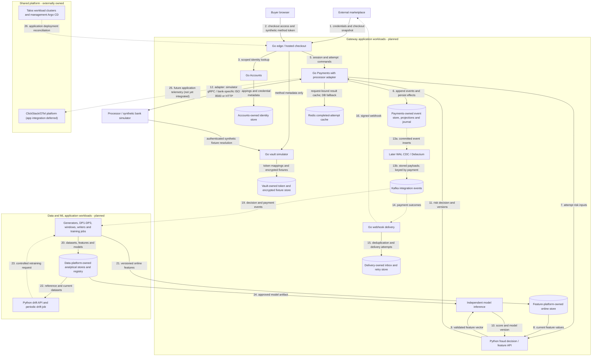

# Payment gateway architecture

This is the **planned target** for an ecommerce payment gateway with fraud decisioning. The repository currently supplies a Go HTTP edge and a Python gRPC fraud service; the target integrates with the refurbished marketplace, takes synthetic payment-method tokens through hosted checkout, evaluates risk, executes simulated processor operations, and delivers durable payment outcomes. It also produces reproducible data for the mini-coursework and its final ML extension.

Companion pages: [payment flows](payment-flows.md) (identity, checkout and payment authority contracts with the checkout sequence), [data and ML flows](data-ml-flows.md) (generators, DP1–DP3, features, training and drift), [service conventions](service-conventions.md) and the [implementation roadmap](roadmap.md). Delivery is tracked on the [project board](https://github.com/users/phuchoang2603/projects/3).

## Functional requirements

These requirements describe the planned system, not delivered behavior. **First slice** means the API-driven synthetic gateway in the [minimum gateway plan](../../openspec/changes/build-minimum-payment-gateway/design.md); **later** means a separate implementation increment.

| ID | Requirement | Delivery / acceptance |
| --- | --- | --- |
| FR-01 | Authenticate integrations, provision merchants idempotently and resolve integration-scoped customer identities. | First slice; reject cross-integration access and conflicting repeated provisioning. |
| FR-02 | Create immutable amount/currency/order snapshots, scoped checkout sessions and idempotent attempts; expose authenticated payment status. | First slice; repeated requests return their stored result and changed content conflicts. Hosted checkout UI follows later. |
| FR-03 | Run an isolated vault simulator that tokenizes allow-listed fictional card fixtures into opaque, integration-scoped tokens. Only the vault owns its token mappings and encrypted fixture records. | First slice; authenticated simulator CLI provisions tokens, Edge can obtain safe method metadata, and only the processor identity can resolve processing fixtures. Reject real card fields and foreign tokens. |
| FR-04 | Request a versioned fraud decision and record it before any processor effect. | First slice; fraud errors fail closed and no processor request follows a risk decline. |
| FR-05 | Execute simulated sales through a provider adapter with a durable effect intent and operation key. | First slice; demonstrate success, processor decline and a lost response without duplicate processing. |
| FR-06 | Recover uncertain operations by querying the simulator and expire only payments without unresolved effects. | First slice; crash/restart converges on one recorded result. Unresolved cases stay pending; no bank-file reconciliation worker is included. |
| FR-07 | Use Redis to cache immutable completed-attempt idempotency results, with tenant/session scope, request binding and TTL. | First slice; cache miss, eviction, restart and outage fall back to durable database behavior without another charge. |
| FR-08 | Publish committed events through WAL CDC/Kafka and deliver signed, deduplicated merchant webhooks with bounded retries. | Later; broker/webhook outages do not block committing payment outcomes. |
| FR-09 | Transmit and parse a named synthetic ISO 8583 bank profile behind the provider adapter. | Later; byte fixtures, framing, correlation, duplicates, late responses and safe uncertainty handling. Live bank connectivity is outside this synthetic scope. |
| FR-10 | Add VND and issuer-authentication scenarios using versioned regulatory, provider and synthetic policy sources. | Later; update contracts, units, lifecycle and generators together; do not reinterpret existing USD or APPROVE/DECLINE semantics. |
| FR-11 | Add separate authorization/capture and refund commands with a balanced journal and captured-amount limits. | Later; replay never repeats a financial effect, and cumulative refunds cannot exceed captured funds. |
| FR-12 | Feed reproducible data/feature pipelines, approved model serving and read-only fraud investigation from scoped committed evidence. | Later; preserve temporal cutoffs, delayed-label separation and independent sink progress. See [data and ML flows](data-ml-flows.md). |

Automated reconciliation, bank settlement-file ingestion, settlement verification, real card custody, live money movement, payouts and FX are outside the revised project scope. Operation-status recovery remains necessary even in simulation; processor success is not a claim of bank settlement.

## Non-functional requirements

The numerical targets below are initial acceptance goals for the synthetic gateway. Record hardware, dataset, configured simulator latency and injected faults with each run; no target is an observed result or a PCI certification claim.

| ID | Requirement | Acceptance target / evidence |
| --- | --- | --- |
| NFR-01 | Durable, strongly consistent payment commands. | Events, idempotency and status commit in one transaction with expected aggregate versions. Concurrent retries and replay produce zero additional processor effects in the acceptance suite. Acknowledged writes survive application restart. |
| NFR-02 | Bounded checkout latency and explicit uncertainty. | Under nominal synthetic load, target p95 attempt response <= 1 s at 50 attempts/s for 10 minutes, with < 0.1% unexpected transport/5xx errors. Risk/processor declines are business outcomes; `FRAUD_UNAVAILABLE` is an operational failure. Fault runs are reported separately; use a 1 s fraud deadline, 3 s processor deadline and 5 s overall attempt budget, returning pending on an uncertain processor result. |
| NFR-03 | Availability with bounded dependency failures. | Initial deployed API objective: 99.9% monthly valid-request availability, counting unexpected 5xx/timeouts, dependency-driven fallback declines and database/vault failures; measure at Edge with a declared probe/window. Redis outage must preserve payment correctness via database fallback. A short smoke test cannot establish the monthly SLO. |
| NFR-04 | Credential isolation and tenant authorization. | Use authenticated, encrypted service transport and least-privilege roles/network policy. Vault is a separate deployable and database owner; other application roles cannot read its tables, and only the processor identity may receive processing fixtures through its API. Encrypt stored fictional fixture payloads with a vault-only key from External Secrets. Keep tokens, raw card fields and fixture payloads out of logs/events/Fraud/Redis/lake. This demonstrates a PCI DSS-oriented boundary using synthetic data, not compliance. |
| NFR-05 | Safe recovery and delivery. | After a one-replica restart or injected lost processor response, resolve known simulator outcomes within 30 s once dependencies return under the stated test load. Never turn unknown into decline solely because time elapsed. Later CDC/webhook delivery is at least once with stable identities and exponential backoff/jitter. |
| NFR-06 | Horizontal growth and later database sharding. | Start with one Payments database and stateless service replicas. Later use a versioned shard directory keyed by `(integration_id, merchant_id)`; colocate each payment's events, idempotency, projection and future journal. Prove routing, tenant isolation, hot-merchant handling, migration/rollback and per-shard CDC before enabling multiple shards. Redis partitioning is a separate decision. |
| NFR-07 | Traceable operations without sensitive payloads. | Propagate correlation/causation IDs and record policy/model/feature versions. Acceptance captures request rates, p95/p99 latency, failures, pending age, cache hit/error rates and vault authorization failures. Add export/dashboards as their telemetry increment lands. |
| NFR-08 | Reproducible, independently deployable services. | Keep domain code free of transport/storage dependencies, version shared contracts, test real persistence boundaries, build per-service images and render the prod GitOps target. Replay rebuilds projections without calling external services. |

## Current foundation

Source and configuration observations, not a fresh verification of running systems.

| Area       | Repository evidence                                                                                                                                                                                                                        | What exists / what remains                                                                                                                                                                    |
| ---------- | ------------------------------------------------------------------------------------------------------------------------------------------------------------------------------------------------------------------------------------------ | --------------------------------------------------------------------------------------------------------------------------------------------------------------------------------------------- |
| Edge       | [`src/edge`](../../src/edge)                                                                                                                                                                                                               | `/health` and `/ready` with correlation; checkout routes, Accounts and Payments are planned.   |
| Fraud      | [`contracts/fraud/v2`](../../contracts/fraud/v2/fraud.proto), [`src/fraud-service`](../../src/fraud-service)                                                                                                                               | `fraud.v2.FraudService/Decide` with validated checkout context, stateless `rules-v1` and gRPC health `liveness`/`readiness`. Online feature retrieval and independent inference are planned.    |
| Quality    | [`ci.yml`](../../.github/workflows/ci.yml), [acceptance criteria](../verification/evidence.md)                                                                                                                                                        | Behavior tests for rules-v1 decisions and required inputs; Go lint; all-chart Helm validation; CI-owned image builds. |
| Deployment | [chart](../../infra/charts/fraud-service/Chart.yaml), [prod root](../../infra/argocd/prod/root.yaml), [GitOps guide](../deployment/gitops.md) | Application resources for shared Talos infrastructure; configured targets do not establish live rollout success. |
| Telemetry  | [metrics](../../src/fraud-service/app/telemetry/metrics_config.py), [logs](../../src/fraud-service/app/telemetry/logging_config.py), [traces](../../src/fraud-service/app/telemetry/tracing_config.py), [guide](../deployment/shared-observability.md) | Structured stdout logs; metrics exposed but not collected; trace export disabled by default. Application dashboards and alerts are deferred.                                                       |
| Research   | [background](../research/ccfd-background.md), [experiments](../research/ccfd-experiements-report.md)                                                                                                                                       | Prior fraud research is context, not acceptance of the planned ecommerce data or model.                                                                                                       |

## Ownership and deployment boundaries

The [marketplace gateway note](https://github.com/phuchoang2603/refurbished-marketplace/blob/main/docs/ecommerce-fraud-gateway.md) supplies commerce context. Marketplace owns buyers, sellers, catalog/prices, carts, orders, shipping choices, and inventory reservation/commit/release. Gateway stores scoped references and immutable checkout snapshots; it does not become their system of record.

The [marketplace architecture](https://github.com/phuchoang2603/refurbished-marketplace/blob/main/docs/architecture.md) is the reference for composition roots, Go modules, transport/domain/persistence separation, service-owned data, inbox/outbox patterns and shared telemetry conventions; this repository's adoption is recorded in [service conventions](service-conventions.md). Shared cluster provisioning, networking, storage operators, secret operators, Argo CD and ClickStack/OTel infrastructure belong to [talos-proxmox](https://github.com/phuchoang2603/talos-proxmox/blob/main/apps/README.md). This repository owns its application deployments and service policies; application telemetry integration is deferred.

| Planned deployable unit                        | Language / role                                                      | Owned state                                                                                 |
| ---------------------------------------------- | -------------------------------------------------------------------- | ------------------------------------------------------------------------------------------- |
| Edge / hosted checkout                         | Go; merchant API and browser checkout boundary                       | Bounded checkout access; authoritative sessions remain with Payments                        |
| Accounts                                       | Go; integration authorization and identity mapping                   | Integration credentials/metadata, merchant accounts, customer mappings                      |
| Vault simulator                                | Go; synthetic tokenization and restricted fixture resolution         | Opaque token mappings, encrypted fictional fixtures and stable method fingerprints         |
| Payments                                       | Go; sessions, attempts, event-sourced payment commands               | Aggregate streams, command results, projections, effect intents, journal, publication state |
| Redis                                          | Payments-owned disposable cache                                     | Request-bound completed-attempt results with TTL; no authoritative payment or vault state   |
| Webhook delivery                               | Go; signed versioned delivery with retries                           | Consumer inbox, subscriptions/delivery attempts, retry state                                |
| Fraud decision / feature API                   | Python; validate inputs, retrieve online features, apply risk policy | Versioned policy and decision metadata; no payment authority                                |
| Model inference                                | Independently deployable Python ML workload                          | Approved immutable model artifact and feature contract                                      |
| Drift API and periodic drift job               | Python; online ingestion and scheduled comparisons                   | Versioned reference windows, drift results, retraining trigger state                        |
| Fraud investigation agent                      | Internal, read-only analyst assistant                                 | Versioned investigation sources and audited retrievals; no payment authority               |
| Historical generator and live simulator        | Data/simulation jobs                                                 | Seeded profiles/scenarios; separate delayed-label truth                                     |
| DP1, DP2, DP3 and streaming windows            | Data jobs with separate observable stages                            | Bronze, curated tables, historical features, checkpoints and validation results             |
| Offline writer, online writer, materialization | Independently deployable jobs                                        | Store-specific writes, checkpoints, freshness/version handling                              |
| Training pipeline                              | Python ML jobs, including distributed workers                        | Versioned training data, metrics and candidate model artifacts                              |

Processor adapters and the financial journal initially live within Payments. An adapter, SDK, aggregate or class is not a separate microservice. Initial gateway storage is specified in the [minimum gateway design](../../openspec/changes/build-minimum-payment-gateway/design.md); data-platform choices are scoped in the [roadmap](roadmap.md#planned-data-platform-direction). Feature-store and inference framework choices remain open.

## Planned deployment view

Solid arrows carry synchronous requests/responses or storage operations. Dotted arrows carry asynchronous events or telemetry. Arrow numbers are local to this diagram; data/training internals are expanded in [data and ML flows](data-ml-flows.md).

Shared platform hosting applies to all gateway/data workloads; the last two edges are representative to keep the view readable and do not give application services ownership of the platform. The simulator CLI tokenizes fictional fixtures directly through the authenticated vault API before checkout. The current processor queries that vault; a future bank connector must define its own credential boundary rather than giving a bank direct access to this service.

## Reference payment gateway alignment

Adopt the reference video's gateway boundaries while retaining the proposed event-sourced payment authority and omitting its bank-file reconciliation path. These are target decisions; the current health-only edge and rules service do not yet implement checkout.

| Reference component | Adopted gateway design |
| --- | --- |
| API gateway and Payment Service | Go Edge, Accounts and Payments; synchronous fraud and provider calls use bounded deadlines. |
| Payment Order and Payment Event | Payments' append-only Postgres event streams are authoritative; current-status projections are rebuildable. Commands atomically persist events, status and idempotency using expected versions. |
| Main ledger | A later Payments-owned balanced financial journal, separate from workflow events. An authorization hold, captured payment and settled funds are different facts. |
| Redis idempotency | Add a bounded Redis cache for completed-attempt results now; durable database constraints still arbitrate retries. Cache loss falls back to Postgres. Distributed rate limiting is a later use with its own failure policy. |
| Outbox, Debezium and Kafka | The committed event table supplies the publication boundary. Later WAL CDC publishes stored payloads to Kafka without a second outbox table. Sequence allocation is not commit order; checkpoint CDC offsets and preserve per-payment versions. |
| Webhook listener and notifications | A separate delivery service owns durable inbox/retry state and signed merchant webhooks; consumers deduplicate stable event IDs. Neither Kafka nor merchant webhook availability blocks the synchronous processor path. |
| External gateway adapter | An adapter maps canonical operations to the processor simulator now and a synthetic bank profile later. ISO 8583 and provider HTTP APIs remain outside payment-domain and fraud contracts. Live connectivity needs separate production scope. |
| Card vault | Keep a separately deployed synthetic vault with its own database, encrypted fictional fixtures, opaque tokens and restricted APIs. It models credential isolation without accepting real card data or establishing PCI DSS compliance. |
| Bank files and reconciliation | Excluded for simplicity. Keep status-based processor recovery and explicit pending outcomes; do not claim settlement verification. |

The initial simulator exposes a combined `Sale`; `PaymentSucceeded` records that provider result, not bank settlement. Separate authorization/capture and refunds require their own lifecycle and journal work. The initial availability objective is NFR-03. Database sharding is an explicit later scaling increment under NFR-06, not part of the first deployment.

### Bank adapter and ISO 8583

Yes, the target must transmit and parse ISO 8583 payloads **when the selected bank/acquirer requires that interface**. The bank-facing adapter owns this translation; browsers, merchant APIs, fraud RPCs, event streams and analytical tables keep their own versioned contracts. [ISO 8583:2023](https://www.iso.org/standard/79451.html) specifies message structure/format and explicitly excludes transport and settlement. A standard number alone is insufficient to connect to a bank.

Before implementing a real bank connection, obtain its integration profile and certification requirements:

- Pin the ISO edition, MTIs, required/conditional fields, bitmap and character/binary encoding, length prefixes/framing, amount/currency mapping and response-code semantics.
- Specify connection lifecycle, network management/echo, deadlines, authentication/encryption, and MAC/HSM/key-management responsibilities where the profile requires them. Do not assume a universal TCP, TLS or HTTP transport.
- Persist a mapping from gateway operation identity to provider context and transaction identifiers. STAN/RRN are correlation fields within a profile, not globally unique replacements for gateway IDs.
- Define duplicate, late, unmatched and malformed response handling; timeout recovery uses the profile's supported query or reversal/advice. If no safe resolution is available, retain pending status and surface it for inspection. A missing response must not trigger an unqualified resend of a financial request. Automated settlement reconciliation is outside scope.
- Keep raw card credentials and sensitive ISO wire fields out of ordinary logs, event payloads, Kafka and the ML lake. Real credential retrieval/encoding must stay within the deliberately scoped cardholder-data environment.

For a concrete example of profile differences, [Worldpay's Lync host format](https://docs.worldpay.com/core/lync-iso-8583-message-specification/host-message-format) uses `0100/0110` for authorization, `0220/0230` for completion/capture, `0400/0410` for reversal, and ASCII hexadecimal bitmaps. Its timeout reversal behavior is part of that provider's interface. This is evidence for profile-specific design, not a Vietnamese-bank field map to copy.

Delivery proceeds from the gRPC operation simulator to a **named synthetic ISO profile with an actual encoded request/response exchange**. The synthetic ISO increment must prove byte fixtures, response correlation, duplicates, late responses and uncertain-outcome recovery without live cards. A selected bank's certified profile would require a separate production scope, including how to verify financial outcomes; live connectivity is not a deliverable of this simplified project. The current gRPC simulator is not an ISO 8583 implementation. The [minimum gateway plan](../../openspec/changes/build-minimum-payment-gateway/design.md#adopted-bank-integration-and-policy-direction) records these follow-up gates.

### Vietnam policy adoption

Use the [Vietnam payment-policy research](../research/vietnam-payment-policy.md) as the source-backed baseline, preserving regulation, provider policy and fictional scenarios as separately versioned material. Introduce a VND profile with coherent units, validation and generator changes; the current fraud input is USD-only. Add issuer-authentication outcomes and pending/expiry/cancellation contracts separately from `fraud.v2` APPROVE/DECLINE. Issuer-wide daily totals must come from issuer fixtures or provider evidence. No real PAN, OTP, PIN, biometric or identity images are needed for this work.

## Delivery sequence

The first working slice is [hosted checkout #37](https://github.com/phuchoang2603/realtime-credit-card-fraud-detection/issues/37) → [rules-based fraud decision #39](https://github.com/phuchoang2603/realtime-credit-card-fraud-detection/issues/39) → simulated capture → durable financial outcome → [signed webhook delivery #40](https://github.com/phuchoang2603/realtime-credit-card-fraud-detection/issues/40) → [marketplace integration #41](https://github.com/phuchoang2603/realtime-credit-card-fraud-detection/issues/41). Demonstrate duplicates, timeouts and recovery before layering in learned risk models. The fraud contract leaves feature retrieval and model inference independently deployable as ML capabilities arrive.

The API-driven first slice includes the isolated vault simulator and Redis result cache. Then accept the mini data baseline, extend it into feature publication/training/serving, and add authorization/capture and refunds. Database sharding follows measured load and migration evidence. Security, infrastructure reproducibility, tests, telemetry and CI/CD begin with the first service and expand with each workload.

## Reference assessment and refactoring direction

The sibling [card-fraud-platform](https://github.com/cvinhnguyen/card-fraud-platform/tree/35d4295a1e5a409fa242bc6aa9eff9b06038c111) is a reference for the data and ML path. Its scoring service is not a payment authority. The following are recommendations for the gateway rework; they do not change the versioned contracts or introduce new runtime dependencies.

- Start with Edge, Accounts, Payments, the existing fraud decision service, a processor simulator, an isolated vault simulator and Redis. Keep recovery and expiry workers inside Payments until independent scaling or isolation is needed. Add webhook delivery when its durable delivery workflow is implemented; features, inference, drift and investigation follow their own acceptance steps.
- Borrow the small injected feature/model clients and pure policy boundary in [`services/scoring_api/app/scorer.py`](https://github.com/cvinhnguyen/card-fraud-platform/blob/35d4295a1e5a409fa242bc6aa9eff9b06038c111/services/scoring_api/app/scorer.py). Add an application coordinator to fraud serving when it actually retrieves features and calls inference; keep internal gRPC and the existing `fraud.v2` contract. Payments retains the recorded fail-closed decision on fraud unavailability. The reference fallback that approves small payments is not suitable for that contract.
- Keep authoritative risk decisions and effect intents in the Payments transaction history. Send monitoring asynchronously from committed records. The reference prediction logger can be unavailable and its queue write is awaited, so it is not a durable payment audit or an unconditional latency guarantee.
- Borrow separate online/offline consumers from [`ml/jobs/push_job.py`](https://github.com/cvinhnguyen/card-fraud-platform/blob/35d4295a1e5a409fa242bc6aa9eff9b06038c111/ml/jobs/push_job.py): each commits offsets after its own sink write and tolerates replay. Reuse one transformation and versioned feature contract; give each sink its own checkpoint and deduplication/version policy. Choose the feature-store implementation with a concrete pipeline rather than copying the reference storage stack.
- Borrow explicit label cutoffs, chronological splits and dataset-version recording from [`ml/fraud_ml/data.py`](https://github.com/cvinhnguyen/card-fraud-platform/blob/35d4295a1e5a409fa242bc6aa9eff9b06038c111/ml/fraud_ml/data.py) and [`split.py`](https://github.com/cvinhnguyen/card-fraud-platform/blob/35d4295a1e5a409fa242bc6aa9eff9b06038c111/ml/fraud_ml/split.py). Derive maturity and warmup from the gateway dataset; do not copy the card-based keys, VND thresholds, sixty-day maturity constant or one-millisecond join adjustment. The gateway training grain remains one attempt with strictly earlier features and labels available at its cutoff.
- Reuse training functions between the notebook and pipeline, as the reference does with `ml/fraud_ml` and its KFP wrappers. Keep orchestration thin. Use the existing Argo/Kubeflow platform, registry and GitHub Actions instead of adding Compose, Airflow, Jenkins, MLflow or another Kubernetes cluster to reproduce the reference environment.

The [Vietnam payment policy research](../research/vietnam-payment-policy.md) separates current regulatory sources, provider policies and fictional simulator assumptions, including authentication and dispute scope.

The first refactor should implement the minimum checkout slice already described in the [minimum gateway design](../../openspec/changes/build-minimum-payment-gateway/design.md), then prove retry, timeout and recovery behavior. Shared storage infrastructure may host separate service-owned databases and credentials; services must not share mutable domain models or query one another's tables.

## Deferred decisions and limits

- Versioned payment events and fraud RPC schemas exist under [`contracts/`](../../contracts). Remaining identity and checkout APIs belong to the minimum gateway implementation.
- Synthetic processing comes first. Real card custody, live processor connectivity, wallets, seller payouts, FX and PCI certification are outside this baseline.
- Availability and fraud quality require measured evidence. There is no five-nines or real-world model-quality claim.
- Fraud is internal-only gRPC on port 8000 with named health probes; the chart creates no public ingress. The Go edge owns HTTP/JSON translation. Gateway exposure and routing policy remain with [#63](https://github.com/phuchoang2603/realtime-credit-card-fraud-detection/issues/63).
- Model traffic experiments [#61](https://github.com/phuchoang2603/realtime-credit-card-fraud-detection/issues/61) record the authoritative model per decision. Shadow inference cannot execute payment effects. Application canary delivery [#28](https://github.com/phuchoang2603/realtime-credit-card-fraud-detection/issues/28) is related but does not itself prove model A/B evaluation.
