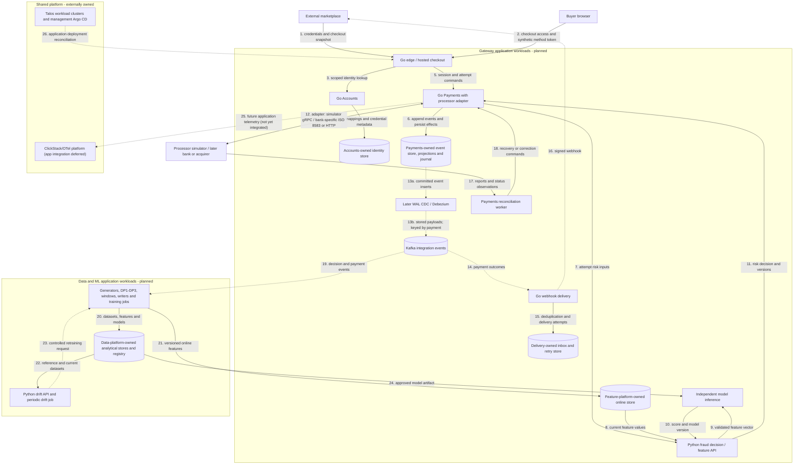

# Payment gateway architecture

This is the **planned target** for an ecommerce payment gateway with fraud decisioning. The repository currently supplies a Go HTTP edge and a Python gRPC fraud service; the target integrates with the refurbished marketplace, takes synthetic payment-method tokens through hosted checkout, evaluates risk, executes simulated processor operations, and delivers durable payment outcomes. It also produces reproducible data for the mini-coursework and its final ML extension.

Companion pages: [payment flows](payment-flows.md) (identity, checkout and payment authority contracts with the checkout sequence), [data and ML flows](data-ml-flows.md) (generators, DP1–DP3, features, training and drift), [service conventions](service-conventions.md) and the [implementation roadmap](roadmap.md). Delivery is tracked on the [project board](https://github.com/users/phuchoang2603/projects/3).

## Current foundation

Source and configuration observations, not a fresh verification of running systems.

| Area       | Repository evidence                                                                                                                                                                                                                        | What exists / what remains                                                                                                                                                                    |
| ---------- | ------------------------------------------------------------------------------------------------------------------------------------------------------------------------------------------------------------------------------------------ | --------------------------------------------------------------------------------------------------------------------------------------------------------------------------------------------- |
| Edge       | [`src/edge`](../../src/edge)                                                                                                                                                                                                               | `/health` and `/ready` with correlation; checkout routes, Accounts and Payments are planned.   |
| Fraud      | [`contracts/fraud/v2`](../../contracts/fraud/v2/fraud.proto), [`src/fraud-service`](../../src/fraud-service)                                                                                                                               | `fraud.v2.FraudService/Decide` with validated checkout context, stateless `rules-v1` and gRPC health `liveness`/`readiness`. Online feature retrieval and independent inference are planned.    |
| Quality    | [`ci.yml`](../../.github/workflows/ci.yml), [acceptance criteria](../verification/evidence.md)                                                                                                                                                        | Behavior tests for rules-v1 decisions and required inputs; Go lint; all-chart Helm validation; CI-owned image builds. |
| Deployment | [chart](../../infra/charts/fraud-service/Chart.yaml), [prod root](../../infra/argocd/prod/root.yaml), [GitOps guide](../deployment/gitops.md) | Application resources for shared Talos infrastructure; configured targets do not establish live rollout success. |
| Telemetry  | [metrics](../../src/fraud-service/app/telemetry/metrics_config.py), [logs](../../src/fraud-service/app/telemetry/logging_config.py), [traces](../../src/fraud-service/app/telemetry/tracing_config.py), [guide](../deployment/shared-observability.md) | Structured stdout logs; metrics exposed but not collected; trace export disabled by default. Application dashboards and alerts are deferred.                                                       |
| Research   | [background](../research/ccfd-background.md), [experiments](../research/ccfd-experiements-report.md)                                                                                                                                       | Prior fraud research is context, not acceptance of the planned ecommerce data or model.                                                                                                       |

## Ownership and deployment boundaries

The [marketplace gateway note](https://github.com/phuchoang2603/refurbished-marketplace/blob/main/docs/ecommerce-fraud-gateway.md) supplies commerce context. Marketplace owns buyers, sellers, catalog/prices, carts, orders, shipping choices, and inventory reservation/commit/release. Gateway stores scoped references and immutable checkout snapshots; it does not become their system of record.

The [marketplace architecture](https://github.com/phuchoang2603/refurbished-marketplace/blob/main/docs/architecture.md) is the reference for composition roots, Go modules, transport/domain/persistence separation, service-owned data, inbox/outbox patterns and shared telemetry conventions; this repository's adoption is recorded in [service conventions](service-conventions.md). Shared cluster provisioning, networking, storage operators, secret operators, Argo CD and ClickStack/OTel infrastructure belong to [talos-proxmox](https://github.com/phuchoang2603/talos-proxmox/blob/main/apps/README.md). This repository owns its application deployments and service policies; application telemetry integration is deferred.

| Planned deployable unit                        | Language / role                                                      | Owned state                                                                                 |
| ---------------------------------------------- | -------------------------------------------------------------------- | ------------------------------------------------------------------------------------------- |
| Edge / hosted checkout                         | Go; merchant API and browser checkout boundary                       | Bounded checkout access; authoritative sessions remain with Payments                        |
| Accounts                                       | Go; integration authorization and identity mapping                   | Integration credentials/metadata, merchant accounts, customer mappings                      |
| Payments                                       | Go; sessions, attempts, event-sourced payment commands               | Aggregate streams, command results, projections, effect intents, journal, publication state |
| Webhook delivery                               | Go; signed versioned delivery with retries                           | Consumer inbox, subscriptions/delivery attempts, retry state                                |
| Fraud decision / feature API                   | Python; validate inputs, retrieve online features, apply risk policy | Versioned policy and decision metadata; no payment authority                                |
| Model inference                                | Independently deployable Python ML workload                          | Approved immutable model artifact and feature contract                                      |
| Drift API and periodic drift job               | Python; online ingestion and scheduled comparisons                   | Versioned reference windows, drift results, retraining trigger state                        |
| Fraud investigation agent                      | Internal, read-only analyst assistant                                 | Versioned investigation sources and audited retrievals; no payment authority               |
| Historical generator and live simulator        | Data/simulation jobs                                                 | Seeded profiles/scenarios; separate delayed-label truth                                     |
| DP1, DP2, DP3 and streaming windows            | Data jobs with separate observable stages                            | Bronze, curated tables, historical features, checkpoints and validation results             |
| Offline writer, online writer, materialization | Independently deployable jobs                                        | Store-specific writes, checkpoints, freshness/version handling                              |
| Training pipeline                              | Python ML jobs, including distributed workers                        | Versioned training data, metrics and candidate model artifacts                              |
| Reconciliation worker                          | Payments-owned worker                                                | Processor observations/discrepancies; corrections go through Payments commands              |

Processor adapters and the financial journal initially live within Payments. An adapter, SDK, aggregate or class is not a separate microservice. Initial gateway storage is specified in the [minimum gateway design](../../openspec/changes/build-minimum-payment-gateway/design.md); data-platform choices are scoped in the [roadmap](roadmap.md#planned-data-platform-direction). Feature-store and inference framework choices remain open.

## Planned deployment view

Solid arrows carry synchronous requests/responses or storage operations. Dotted arrows carry asynchronous events or telemetry. Arrow numbers are local to this diagram; data/training internals are expanded in [data and ML flows](data-ml-flows.md).

Shared platform hosting applies to all gateway/data workloads; the last two edges are representative to keep the view readable and do not give application services ownership of the platform.

## Reference payment gateway alignment

Adopt the reference video's gateway boundaries while retaining the proposed event-sourced payment authority. These are target decisions; the current health-only edge and rules service do not yet implement checkout.

| Reference component | Adopted gateway design |
| --- | --- |
| API gateway and Payment Service | Go Edge, Accounts and Payments; synchronous fraud and provider calls use bounded deadlines. |
| Payment Order and Payment Event | Payments' append-only Postgres event streams are authoritative; current-status projections are rebuildable. Commands atomically persist events, status and idempotency using expected versions. |
| Main ledger | A later Payments-owned balanced financial journal, separate from workflow events. An authorization hold, captured payment and settled funds are different facts. |
| Redis idempotency | Durable database constraints, request binding and stored results arbitrate retries. Redis may later support caching/rate limits; losing a cache entry must not permit another charge. |
| Outbox, Debezium and Kafka | The committed event table supplies the publication boundary. Later WAL CDC publishes stored payloads to Kafka without a second outbox table. Sequence allocation is not commit order; checkpoint CDC offsets and preserve per-payment versions. |
| Webhook listener and notifications | A separate delivery service owns durable inbox/retry state and signed merchant webhooks; consumers deduplicate stable event IDs. Neither Kafka nor merchant webhook availability blocks the synchronous processor path. |
| External gateway adapter | An adapter maps canonical operations to the synthetic processor now and a chosen bank/acquirer profile later. ISO 8583 and provider HTTP APIs remain outside payment-domain and fraud contracts. |
| Card vault | Synthetic tokens first. Real card collection later needs an isolated vault or hosted tokenization integration and a reviewed cardholder-data environment, including any connector that handles credentials. A vault alone does not establish PCI DSS compliance. |
| Bank files and reconciliation | A worker compares provider reports using stable operation identifiers and requests corrective Payments commands. It does not directly edit aggregate events or journal rows. |

The initial simulator exposes a combined `Sale`; `PaymentSucceeded` records that provider result, not bank settlement. Separate authorization/capture, refunds and settlement require their own lifecycle and journal work. Five-nines availability is a possible future SLO requiring a failure model and measured evidence, not a property established by this diagram. Merchant sharding is deferred until load and access patterns justify it; it must preserve aggregate and idempotency ownership.

### Bank adapter and ISO 8583

Yes, the target must transmit and parse ISO 8583 payloads **when the selected bank/acquirer requires that interface**. The bank-facing adapter owns this translation; browsers, merchant APIs, fraud RPCs, event streams and analytical tables keep their own versioned contracts. [ISO 8583:2023](https://www.iso.org/standard/79451.html) specifies message structure/format and explicitly excludes transport and settlement. A standard number alone is insufficient to connect to a bank.

Before implementing a real bank connection, obtain its integration profile and certification requirements:

- Pin the ISO edition, MTIs, required/conditional fields, bitmap and character/binary encoding, length prefixes/framing, amount/currency mapping and response-code semantics.
- Specify connection lifecycle, network management/echo, deadlines, authentication/encryption, and MAC/HSM/key-management responsibilities where the profile requires them. Do not assume a universal TCP, TLS or HTTP transport.
- Persist a mapping from gateway operation identity to provider context and transaction identifiers. STAN/RRN are correlation fields within a profile, not globally unique replacements for gateway IDs.
- Define duplicate, late, unmatched and malformed response handling; timeout recovery uses the profile's supported query, reversal/advice or settlement reconciliation. A missing response must not trigger an unqualified resend of a financial request.
- Keep raw card credentials and sensitive ISO wire fields out of ordinary logs, event payloads, Kafka and the ML lake. Real credential retrieval/encoding must stay within the deliberately scoped cardholder-data environment.

For a concrete example of profile differences, [Worldpay's Lync host format](https://docs.worldpay.com/core/lync-iso-8583-message-specification/host-message-format) uses `0100/0110` for authorization, `0220/0230` for completion/capture, `0400/0410` for reversal, and ASCII hexadecimal bitmaps. Its timeout reversal behavior is part of that provider's interface. This is evidence for profile-specific design, not a Vietnamese-bank field map to copy.

Delivery proceeds from the gRPC operation simulator to a **named synthetic ISO profile with an actual encoded request/response exchange**, then a selected bank's certified profile. The synthetic ISO increment must prove byte fixtures, response correlation, duplicates, late responses and uncertain-outcome recovery without live cards. The current gRPC simulator is not an ISO 8583 implementation. The [minimum gateway plan](../../openspec/changes/build-minimum-payment-gateway/design.md#adopted-bank-integration-and-policy-direction) records these follow-up gates.

### Vietnam policy adoption

Use the [Vietnam payment-policy research](../research/vietnam-payment-policy.md) as the source-backed baseline, preserving regulation, provider policy and fictional scenarios as separately versioned material. Introduce a VND profile with coherent units, validation and generator changes; the current fraud input is USD-only. Add issuer-authentication outcomes and pending/expiry/cancellation contracts separately from `fraud.v2` APPROVE/DECLINE. Issuer-wide daily totals must come from issuer fixtures or provider evidence. No real PAN, OTP, PIN, biometric or identity images are needed for this work.

## Delivery sequence

The first working slice is [hosted checkout #37](https://github.com/phuchoang2603/realtime-credit-card-fraud-detection/issues/37) → [rules-based fraud decision #39](https://github.com/phuchoang2603/realtime-credit-card-fraud-detection/issues/39) → simulated capture → durable financial outcome → [signed webhook delivery #40](https://github.com/phuchoang2603/realtime-credit-card-fraud-detection/issues/40) → [marketplace integration #41](https://github.com/phuchoang2603/realtime-credit-card-fraud-detection/issues/41). Demonstrate duplicates, timeouts and recovery before layering in learned risk models. The fraud contract leaves feature retrieval and model inference independently deployable as ML capabilities arrive.

Then accept the mini data baseline, extend it into feature publication/training/serving, and complete refunds and reconciliation. Security, infrastructure reproducibility, tests, telemetry and CI/CD begin with the first service and expand with each workload.

## Reference assessment and refactoring direction

The sibling [card-fraud-platform](https://github.com/cvinhnguyen/card-fraud-platform/tree/35d4295a1e5a409fa242bc6aa9eff9b06038c111) is a reference for the data and ML path. Its scoring service is not a payment authority. The following are recommendations for the gateway rework; they do not change the versioned contracts or introduce new runtime dependencies.

- Start with Edge, Accounts, Payments, the existing fraud decision service and a processor simulator. Keep recovery and expiry workers inside Payments until independent scaling or isolation is needed. Add webhook delivery when its durable delivery workflow is implemented; features, inference, drift and investigation follow their own acceptance steps.
- Borrow the small injected feature/model clients and pure policy boundary in [`services/scoring_api/app/scorer.py`](https://github.com/cvinhnguyen/card-fraud-platform/blob/35d4295a1e5a409fa242bc6aa9eff9b06038c111/services/scoring_api/app/scorer.py). Add an application coordinator to fraud serving when it actually retrieves features and calls inference; keep internal gRPC and the existing `fraud.v2` contract. Payments retains the recorded fail-closed decision on fraud unavailability. The reference fallback that approves small payments is not suitable for that contract.
- Keep authoritative risk decisions and effect intents in the Payments transaction history. Send monitoring asynchronously from committed records. The reference prediction logger can be unavailable and its queue write is awaited, so it is not a durable payment audit or an unconditional latency guarantee.
- Borrow separate online/offline consumers from [`ml/jobs/push_job.py`](https://github.com/cvinhnguyen/card-fraud-platform/blob/35d4295a1e5a409fa242bc6aa9eff9b06038c111/ml/jobs/push_job.py): each commits offsets after its own sink write and tolerates replay. Reuse one transformation and versioned feature contract; give each sink its own checkpoint and deduplication/version policy. Choose the feature-store implementation with a concrete pipeline rather than copying the reference storage stack.
- Borrow explicit label cutoffs, chronological splits and dataset-version recording from [`ml/fraud_ml/data.py`](https://github.com/cvinhnguyen/card-fraud-platform/blob/35d4295a1e5a409fa242bc6aa9eff9b06038c111/ml/fraud_ml/data.py) and [`split.py`](https://github.com/cvinhnguyen/card-fraud-platform/blob/35d4295a1e5a409fa242bc6aa9eff9b06038c111/ml/fraud_ml/split.py). Derive maturity and warmup from the gateway dataset; do not copy the card-based keys, VND thresholds, sixty-day maturity constant or one-millisecond join adjustment. The gateway training grain remains one attempt with strictly earlier features and labels available at its cutoff.
- Reuse training functions between the notebook and pipeline, as the reference does with `ml/fraud_ml` and its KFP wrappers. Keep orchestration thin. Use the existing Argo/Kubeflow platform, registry and GitHub Actions instead of adding Compose, Airflow, Jenkins, MLflow or another Kubernetes cluster to reproduce the reference environment.

The [Vietnam payment policy research](../research/vietnam-payment-policy.md) separates current regulatory sources, provider policies and fictional simulator assumptions, including authentication and dispute scope.

The first refactor should implement the minimum checkout slice already described in the [minimum gateway design](../../openspec/changes/build-minimum-payment-gateway/design.md), then prove retry, timeout and recovery behavior. Shared storage infrastructure may host separate service-owned databases and credentials; services must not share mutable domain models or query one another's tables.

## Deferred decisions and limits

- Versioned payment events and fraud RPC schemas exist under [`contracts/`](../../contracts). Remaining identity and checkout APIs belong to the minimum gateway implementation.
- Synthetic processing comes first. Real card custody, live processor connectivity, wallets, seller payouts, FX and PCI certification are outside this baseline.
- Availability and fraud quality require measured evidence. There is no five-nines or real-world model-quality claim.
- Fraud is internal-only gRPC on port 8000 with named health probes; the chart creates no public ingress. The Go edge owns HTTP/JSON translation. Gateway exposure and routing policy remain with [#63](https://github.com/phuchoang2603/realtime-credit-card-fraud-detection/issues/63).
- Model traffic experiments [#61](https://github.com/phuchoang2603/realtime-credit-card-fraud-detection/issues/61) record the authoritative model per decision. Shadow inference cannot execute payment effects. Application canary delivery [#28](https://github.com/phuchoang2603/realtime-credit-card-fraud-detection/issues/28) is related but does not itself prove model A/B evaluation.
