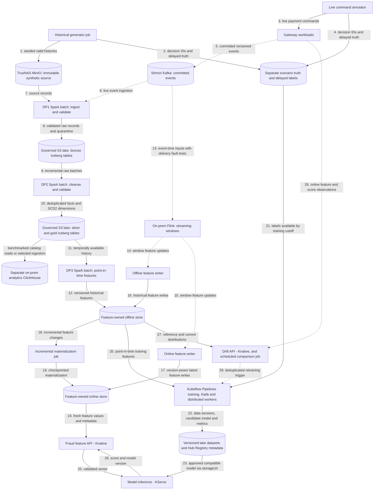

# Data pipeline architecture

Planned generators, DP1–DP3 pipelines and feature stores. Deployable units and the deployment view are in the [platform architecture](../overview/architecture.md); payment contracts are in [payment flows](../payment-gateway/payment-flows.md). The [ML pipeline architecture](ml-pipeline.md) covers training and drift monitoring. Capability coverage and required proof are tracked in the [roadmap](../overview/roadmap.md).

## Flow

This is a target flow, not a claim that its data engines, catalog or warehouse are deployed. Solid arrows show batch/storage transfers and synchronous reads; dotted arrows show streaming events or asynchronous triggers. Storage nodes are labelled by role; feature-access libraries are embedded in jobs/APIs rather than depicted as deployable services.

## Generation

Historical generation persists valid lifecycle histories outside bronze and outside production payment event storage. Live simulation calls gateway commands so Payments creates authoritative events. Both modes share versioned scenarios for customer, seller, device and synthetic method profiles: ordinary purchases, stolen-card/new-device behavior, unusual geography, reshipping, card testing and retry attacks. Burst, lateness and duplicate delivery are transport conditions; they never fabricate duplicate authoritative transitions.

## Pipelines and schemas

The [data products guide](data-products.md) describes the source interface, agreement and validation workflow. Curated dataset contracts are added with their pipelines.

DP1 ingests and validates raw records; DP2 cleanses and curates them; DP3 computes historical features. Each has observable ingest/validate stages, reusable centrally managed connections/configuration, quarantine or failed-validation evidence, and source/table/job lineage. Bronze uses `raw_`, silver `stg_`, and gold `dim_`, `fact_`, `obt_`, `feat_` conventions. SCD2 dimensions carry `valid_from_ts`, `valid_to_ts`, `is_current`; feature tables carry `event_timestamp` and `created`.

Argo Workflows coordinates finite on-prem Spark batch stages and their retries; a Spark-on-Kubernetes operator is a candidate only if it improves lifecycle management over native Spark jobs. The future Iceberg REST-compatible catalog controls multi-engine snapshots over separate governed MinIO lake buckets; the synthetic source bucket remains immutable input, not an Iceberg table. Compaction, snapshot expiration, orphan cleanup and retention are explicit maintenance work. A separately owned analytical ClickHouse deployment evaluates catalog-backed reads against ingesting selected data into local analytical tables; the existing ClickStack telemetry store is not reused as a warehouse.

Streaming windows specify event time, watermarks, allowed lateness, deduplication and restart semantics. Offline and online writers are independently observable, each committing offsets only after its own sink write and tolerating replay without duplicating feature effects; one shared transformation and versioned feature contract feeds both, with each sink keeping its own checkpoint and deduplication/version policy. Incremental materialization has checkpoints, retries and version-aware idempotency; older late writes cannot replace newer online state. Per-feature TTL, stale/missing defaults and feature-version compatibility protect serving.

Long-running Flink jobs and their checkpoints stay on premises near Kafka and the lake. Local Spark is the batch baseline. AWS burst evaluation may stage an immutable versioned snapshot *one way* from MinIO to AWS S3 for a bounded Spark backfill; cloud outputs stay in separate S3 storage until validated and selectively imported. No live bidirectional Iceberg/catalog replication, cross-WAN Flink state or unmeasured large Spark deployment on today's stateless AWS workers.

## Shared storage and service boundaries

Shared storage infrastructure may host separate service-owned databases and credentials; services must not share mutable domain models or query one another's tables. Start with Edge, Payments, the existing fraud decision service, a processor simulator, an isolated vault simulator, Redis, Kafka and the webhook notifier. Integration configuration and derived IDs replace Accounts. Keep recovery and expiry workers inside Payments until independent scaling or isolation is needed; features, inference, drift and investigation follow their own acceptance steps.

The [Vietnam payment policy research](../research/vietnam-payment-policy.md) separates current regulatory sources, provider policies and fictional simulator assumptions, including authentication and dispute scope.
