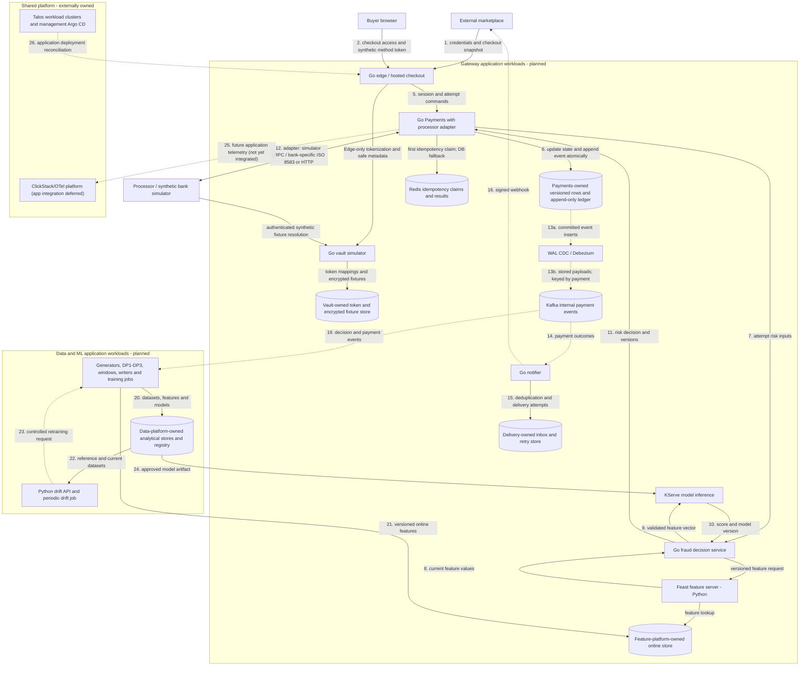

# Platform architecture

This is the **planned target** for an ecommerce payment gateway with fraud decisioning. The repository implements Edge, Payments, notifier, vault and processor simulators alongside Go fraud at `src/payment-gateway/fraud`. Common six-service telemetry awaits CI and deployed acceptance; Feast/KServe integration follows later. Production acceptance remains subject to the [gateway verification evidence](../deployment/gitops.md#gateway-verification). The gateway integrates with the refurbished marketplace, takes synthetic payment-method tokens through hosted checkout, evaluates risk, executes simulated processor operations, and delivers durable payment outcomes. It also produces reproducible data for the mini-coursework and its final ML extension.

The [marketplace gateway note](https://github.com/phuchoang2603/refurbished-marketplace/blob/main/docs/ecommerce-fraud-gateway.md) supplies commerce context. Marketplace owns buyers, sellers, catalog/prices, carts, orders, shipping choices, and inventory reservation/commit/release. Gateway stores scoped references and immutable checkout snapshots; it does not become their system of record. Shared cluster provisioning, networking, storage operators, secret operators, Argo CD and ClickStack/OTel infrastructure belong to [talos-proxmox](https://github.com/phuchoang2603/talos-proxmox/tree/main/docs/architecture); this repository owns its application deployments and service policies, with application telemetry integration deferred.

## How the platform is organized

- [Payment gateway architecture](../payment-gateway/architecture.md): checkout, fraud decisioning, simulated processing and durable outcomes.
- [Payment flows](../payment-gateway/payment-flows.md): identity, checkout and payment-authority contracts, with the checkout and recovery sequence.
- [Service conventions](../payment-gateway/service-conventions.md): code layout, dependency direction and per-service ownership rules.
- [Data pipeline architecture](../data-ml/data-pipeline.md): generators, DP1–DP3 pipelines and feature stores.
- [ML pipeline architecture](../data-ml/ml-pipeline.md): training, serving and drift monitoring.
- [Fraud investigation architecture](../rag/fraud-investigation.md): planned read-only retrieval agent over recorded payment and fraud evidence.

## Deployable units and owned state

| Planned deployable unit                        | Language / role                                                      | Owned state                                                                                 |
| ---------------------------------------------- | -------------------------------------------------------------------- | ---------------------------------------------------------------------------------------------- |
| Edge / hosted checkout                         | Go; integration configuration, merchant API and browser checkout boundary                       | Bounded checkout access; authoritative sessions remain with Payments                        |
| Vault simulator                                | Go; synthetic tokenization and restricted fixture resolution         | Opaque token mappings, encrypted fictional fixtures and stable method fingerprints         |
| Payments                                       | Go; sessions, attempts, versioned payment commands               | Versioned payment/attempt rows, append-only ledger, idempotency and encrypted effect intents |
| Redis                                          | Payments-owned first idempotency check                                     | Atomic in-flight claims and completed results with TTL; Postgres arbitrates conflicts   |
| Notifier                                       | Go; signed versioned delivery with retries                           | Consumer inbox, subscriptions/delivery attempts, retry state                                |
| Fraud decision service                         | Go; validate inputs, call Feast and KServe, apply risk policy         | Versioned policy and decision metadata; no payment authority                                |
| Feast feature server                           | Python Feast runtime; feature retrieval and on-demand transformations | Feature definitions/registry and online-store access; no decision or payment authority        |
| Model inference                                | KServe predictor; Python or another selected model runtime            | Approved immutable model artifact and feature contract                                      |
| Drift API and periodic drift job               | Python; online ingestion and scheduled comparisons                   | Versioned reference windows, drift results, retraining trigger state                        |
| Fraud investigation agent                      | Internal, read-only analyst assistant                                 | Versioned investigation sources and audited retrievals; no payment authority               |
| Historical generator and live simulator        | Data/simulation jobs                                                 | Seeded profiles/scenarios; separate delayed-label truth                                     |
| DP1, DP2, DP3 and streaming windows            | Data jobs with separate observable stages                            | Bronze, curated tables, historical features, checkpoints and validation results             |
| Offline writer, online writer, materialization | Independently deployable jobs                                        | Store-specific writes, checkpoints, freshness/version handling                              |
| Training pipeline                              | Python ML jobs, including distributed workers                        | Versioned training data, metrics and candidate model artifacts                              |

The processor transport adapter lives within Payments; the financial journal remains later work. Merchant/customer IDs are UUIDv5 values derived in Payments from Edge-configured integrations and external seller/buyer IDs; there is no Accounts service or provisioning call. An adapter, SDK, aggregate or class is not a separate microservice. Initial gateway storage is specified in the [minimum gateway design](../../openspec/changes/archive/2026-10-23-build-minimum-payment-gateway/design.md); data-platform choices are scoped in the [roadmap](roadmap.md#planned-data-platform-direction). The planned serving choices are Feast and KServe: Go fraud calls each directly, without a custom Python coordinator. Their deployments and Knative scaling require later acceptance; the rules-service replacement does not depend on them.

## Planned deployment view

Solid arrows carry synchronous requests/responses or storage operations. Dotted arrows carry asynchronous events or telemetry. Arrow numbers are local to this diagram; data/training internals are expanded in the [data pipeline architecture](../data-ml/data-pipeline.md).

Shared platform hosting applies to all gateway/data workloads; the last two edges are representative to keep the view readable and do not give application services ownership of the platform. Only Edge tokenizes allow-listed test cards, through the hosted form or synthetic-only payment-method route. Integrations consume signed HTTP webhooks and status queries; Kafka remains internal. The current processor queries that vault; a future bank connector must define its own credential boundary rather than giving a bank direct access to this service.

## Reference material

The [marketplace architecture](https://github.com/phuchoang2603/refurbished-marketplace/blob/main/docs/architecture.md) is the reference for composition roots, Go modules, transport/domain/persistence separation, service-owned data, inbox/outbox patterns and shared telemetry conventions; this repository's adoption is recorded in [service conventions](../payment-gateway/service-conventions.md).
