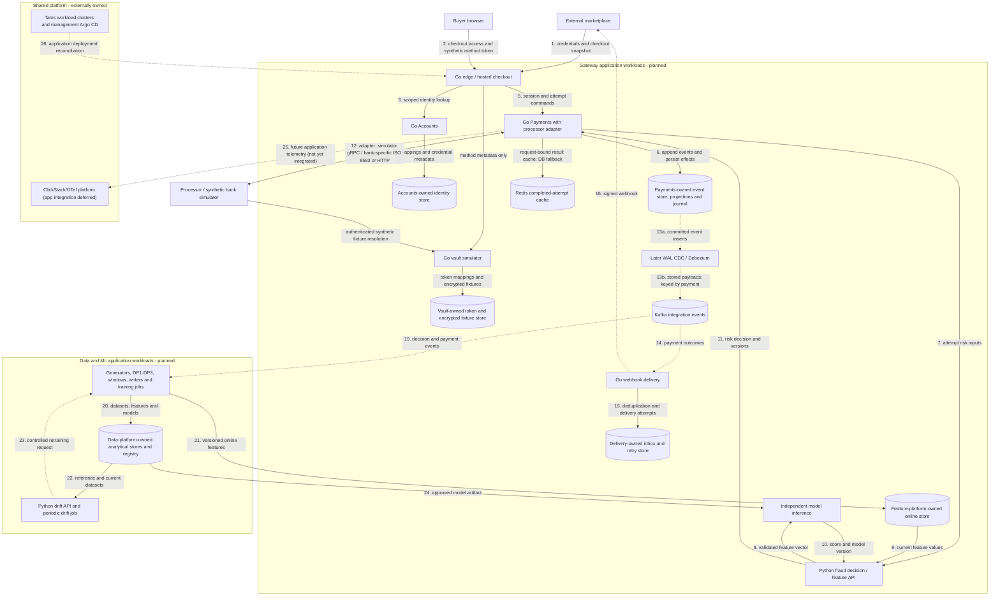

# Platform architecture

This is the **planned target** for an ecommerce payment gateway with fraud decisioning. The repository currently supplies a Go HTTP edge and a Python gRPC fraud service; the target integrates with the refurbished marketplace, takes synthetic payment-method tokens through hosted checkout, evaluates risk, executes simulated processor operations, and delivers durable payment outcomes. It also produces reproducible data for the mini-coursework and its final ML extension.

The [marketplace gateway note](https://github.com/phuchoang2603/refurbished-marketplace/blob/main/docs/ecommerce-fraud-gateway.md) supplies commerce context. Marketplace owns buyers, sellers, catalog/prices, carts, orders, shipping choices, and inventory reservation/commit/release. Gateway stores scoped references and immutable checkout snapshots; it does not become their system of record. Shared cluster provisioning, networking, storage operators, secret operators, Argo CD and ClickStack/OTel infrastructure belong to [talos-proxmox](https://github.com/phuchoang2603/talos-proxmox/blob/main/apps/README.md); this repository owns its application deployments and service policies, with application telemetry integration deferred.

## How the platform is organized

- [Payment gateway architecture](../payment-gateway/architecture.md): checkout, fraud decisioning, simulated processing and durable outcomes.
- [Payment flows](../payment-gateway/payment-flows.md): identity, checkout and payment-authority contracts, with the checkout and recovery sequence.
- [Service conventions](../payment-gateway/service-conventions.md): code layout, dependency direction and per-service ownership rules.
- [Data pipeline architecture](../data-ml/data-pipeline.md): generators, DP1–DP3 pipelines and feature stores.
- [ML pipeline architecture](../data-ml/ml-pipeline.md): training, serving and drift monitoring.
- [Fraud investigation architecture](../rag/fraud-investigation.md): planned read-only retrieval agent over recorded payment and fraud evidence.

## Deployable units and owned state

| Planned deployable unit                        | Language / role                                                      | Owned state                                                                                 |
| ---------------------------------------------- | -------------------------------------------------------------------- | ---------------------------------------------------------------------------------------------- |
| Edge / hosted checkout                         | Go; merchant API and browser checkout boundary                       | Bounded checkout access; authoritative sessions remain with Payments                        |
| Accounts                                       | Go; integration authorization and identity mapping                   | Integration credentials/metadata, merchant accounts, customer mappings                      |
| Vault simulator                                | Go; synthetic tokenization and restricted fixture resolution         | Opaque token mappings, encrypted fictional fixtures and stable method fingerprints         |
| Payments                                       | Go; sessions, attempts, event-sourced payment commands               | Aggregate streams, command results, projections, effect intents, journal, publication state |
| Redis                                          | Payments-owned disposable cache                                     | Request-bound completed-attempt results with TTL; no authoritative payment or vault state   |
| Webhook delivery                               | Go; signed versioned delivery with retries                           | Consumer inbox, subscriptions/delivery attempts, retry state                                |
| Fraud decision / feature API                   | Python; validate inputs, retrieve online features, apply risk policy | Versioned policy and decision metadata; no payment authority                                |
| Model inference                                | Independently deployable Python ML workload                          | Approved immutable model artifact and feature contract                                      |
| Drift API and periodic drift job               | Python; online ingestion and scheduled comparisons                   | Versioned reference windows, drift results, retraining trigger state                        |
| Fraud investigation agent                      | Internal, read-only analyst assistant                                 | Versioned investigation sources and audited retrievals; no payment authority               |
| Historical generator and live simulator        | Data/simulation jobs                                                 | Seeded profiles/scenarios; separate delayed-label truth                                     |
| DP1, DP2, DP3 and streaming windows            | Data jobs with separate observable stages                            | Bronze, curated tables, historical features, checkpoints and validation results             |
| Offline writer, online writer, materialization | Independently deployable jobs                                        | Store-specific writes, checkpoints, freshness/version handling                              |
| Training pipeline                              | Python ML jobs, including distributed workers                        | Versioned training data, metrics and candidate model artifacts                              |

Processor adapters and the financial journal initially live within Payments. An adapter, SDK, aggregate or class is not a separate microservice. Initial gateway storage is specified in the [minimum gateway design](../../openspec/changes/build-minimum-payment-gateway/design.md); data-platform choices are scoped in the [roadmap](roadmap.md#planned-data-platform-direction). Feature-store and inference framework choices remain open.

## Planned deployment view

Solid arrows carry synchronous requests/responses or storage operations. Dotted arrows carry asynchronous events or telemetry. Arrow numbers are local to this diagram; data/training internals are expanded in the [data pipeline architecture](../data-ml/data-pipeline.md).

Shared platform hosting applies to all gateway/data workloads; the last two edges are representative to keep the view readable and do not give application services ownership of the platform. The simulator CLI tokenizes fictional fixtures directly through the authenticated vault API before checkout. The current processor queries that vault; a future bank connector must define its own credential boundary rather than giving a bank direct access to this service.

## Reference material

The [marketplace architecture](https://github.com/phuchoang2603/refurbished-marketplace/blob/main/docs/architecture.md) is the reference for composition roots, Go modules, transport/domain/persistence separation, service-owned data, inbox/outbox patterns and shared telemetry conventions; this repository's adoption is recorded in [service conventions](../payment-gateway/service-conventions.md).
