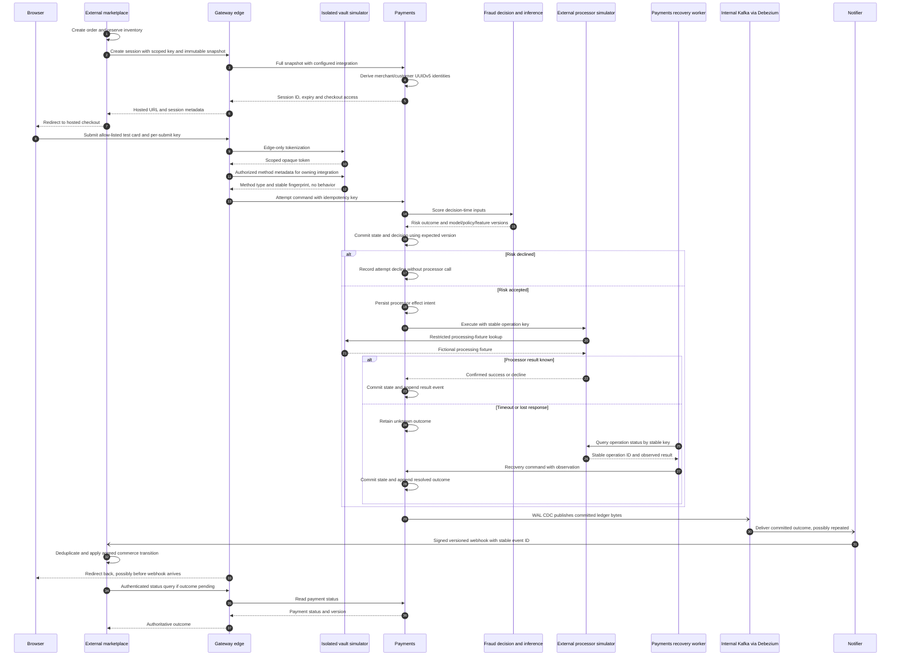

# Payment flows

Identity, checkout and payment-authority contracts for the planned gateway, with the checkout and recovery sequence. Deployable units and the deployment view are in the [platform architecture](../overview/architecture.md); data and training flows are in the [data pipeline architecture](../data-ml/data-pipeline.md).

## Identity and checkout contract

Edge loads integration IDs, SHA-256 API key hashes and synthetic flags from configuration. Payments derives merchant and customer UUIDv5 values from `(integration_id, external_seller_id)` and `(integration_id, external_buyer_id)` using the [shared vectors](../../contracts/synthetic/identity-vectors.json). There is no Accounts service or merchant/customer provisioning call. Buyer authentication stays at the marketplace; the gateway receives account ages and commerce facts in one immutable payment snapshot.

`POST /v1/payments` accepts `order_reference`, `seller` and `buyer` (`external_id`, `account_created_at`), `amount` (`minor_units`, `currency`), `items` (`product_id`, `category`, `condition`, `quantity`, integer `unit_price` in the total currency), `shipping_address` (`name`, `line1`, `line2`, `city`, `region`, `postal_code`, `country`) and an absolute HTTPS `return_url`. It requires `Authorization: Bearer <integration API key>` and `Idempotency-Key`; `GET /v1/payments/{payment_id}` uses the same integration credential. The response supplies `payment_id`, `session_id`, `checkout_token`, `checkout_url` and `expires_at`. Repeating a key with changed content conflicts; order references are unique per integration.

`POST /v1/checkout/sessions/{session_id}/attempts` takes `payment_method_token` and optional `device_fingerprint`, `user_agent_family` and synthetic-only `simulated_client` (`ip_country`, `ip_network`) context, authenticated with `Authorization: Bearer <checkout token>` and `Idempotency-Key`. Results are `SUCCEEDED`, `DECLINED` with `reason`, or `PENDING`. Tokens are base64url of the 16-byte session UUID, eight-byte big-endian Unix expiry and HMAC-SHA256 over those 24 bytes; verification needs no stored token. The hosted page exchanges its URL token for a secure, HTTP-only, session-path cookie, protects submissions against cross-site requests, and retains one key across a repeated form submission. A decline leaves the payment open for another attempt; success redirects to the validated return URL. Signed webhooks and status queries determine commerce outcomes, never that redirect alone.

The marketplace's [current webhook handler](https://github.com/phuchoang2603/refurbished-marketplace/blob/main/services/payment/internal/service/gateway_webhook.go) treats failed sessions as terminal and suppresses subsequent terminal outcomes. Target retries under the same order therefore require a contract change: the marketplace integration contract must separate attempt decline from final payment failure, specify expiry/late-success handling, and coordinate inventory behavior with marketplace.

## Isolated synthetic vault

Only Edge calls vault tokenization: the hosted form accepts an allow-listed test card number, and synthetic integrations can call `POST /v1/payment-methods` with `card_number` plus their integration credential and idempotency header. Both paths immediately discard the number after vault tokenization. The vault issues opaque random integration-scoped tokens, stores digests and encrypted fictional fixtures, and rejects every number outside its Luhn-valid allow-list. Numbers, tokens and bodies are excluded from access logs and traces. This is a synthetic boundary; real card collection remains outside scope.

At attempt submission, Edge authenticates checkout access and calls the vault's restricted metadata API with the resolved integration identity. The response contains only method type and a stable fingerprint, derived from the fixture's card identity with the shared synthetic fingerprint key. It excludes token behavior and fixture contents. Thus token rotation does not change the card fingerprint or break historical/live identity parity. Unknown, inactive or foreign tokens are rejected before starting an attempt.

Only the authenticated processor-simulator identity may resolve a token to its fictional processing fixture. Payments stores an encrypted opaque token in a private operation-request record, committed with the effect intent, so crash recovery can submit an operation that was never received. Clear that encrypted token when the terminal outcome commits. Payments records only the safe method fingerprint in its existing event contract and never reads the vault database. Token values and fixture payloads must not enter event history, Fraud inputs, Redis or analytics. Known operation-status recovery needs no new token resolution. The isolation models a PCI DSS-oriented boundary; it does not establish compliance.

## Payment authority and recovery

Payments owns authoritative versioned payment and attempt rows. Each transition uses the expected row version and atomically commits the state update, exactly one append-only `PaymentEvent` and idempotency state. The runtime role can only read/insert ledger rows; triggers reject update, delete and truncate for every role. Commands and workers read current rows rather than rehydrate event history. Event versions establish per-payment order; correlation IDs connect the calls, without a separate causation field.

Persist an external-effect intent before calling the processor and reuse a stable operation key on retries. A timeout means **unknown**, not declined: query the simulator by operation key before deciding whether another operation is safe. Record discovered results as new events. The project omits automated reconciliation and bank settlement files. A later synthetic ISO profile must define its supported query or reversal/advice; if it cannot safely resolve an operation, leave it pending for inspection instead of blindly resending. The gRPC simulator's idempotent `Sale` and `GetOperation` are not universal bank capabilities.

Each attempt records the `fraud.v1` risk assessment before a processor request. Fraud unavailability/timeouts fail closed with `DECLINE`, `FRAUD_UNAVAILABLE` and `payments-fallback-v1`, without calling the processor. The default overall attempt budget is 5 s, with 1 s for fraud and 3 s for the processor; a lost response after committed intent remains pending. Recovery and expiry workers use advisory-lock leadership and expected versions. Expiry waits for unresolved processor effects.

Debezium publishes committed `payment_events` bytes through WAL CDC to the internal `payments.events.v1` topic, keyed by payment. A `bigserial` position identifies a ledger row but does not establish commit order. The notifier consumes that topic, records one delivery per event ID, and sends subscribed `attempt.declined`, `payment.succeeded` and `payment.expired` JSON webhooks. `Idempotency-Key` carries the event ID; `Gateway-Signature: t=<unix>,v1=<hex>` signs the timestamp, a dot and the exact body with HMAC-SHA256. Receivers check a five-minute timestamp window and deduplicate event IDs. Broker or webhook outages do not block payment commits.

Redis is the first idempotency check for creation and attempts: `SET NX` claims a digest-bound in-flight key, then completion stores its result after commit. TTL defaults to 24 h, bounded memory uses `noeviction`, and operations have a 50 ms deadline. Postgres uniqueness remains the final arbiter on a miss, restart, timeout or outage. Records contain no method token, checkout credential or request body. Edge computes address and /24 IPv4 or /48 IPv6 network fingerprints; only coarse shipping location and fingerprints travel internally. Synthetic integrations use the shared non-secret fingerprint key and may supply simulated network/country; real integrations use a secret key and cannot submit simulated context.

The [bank adapter](architecture.md#bank-adapter-and-iso-8583) translates gateway operations to a selected ISO 8583 or HTTP provider profile. Keep wire encoding, network/session management and bank-specific identifiers out of the domain aggregate. Fraud approval permits proceeding; issuer authentication verifies a separate concern, authorization can reserve funds, capture confirms a financial operation and settlement is established through provider evidence. The minimum synthetic `Sale` path does not implement all these stages.

Financial postings are distinct from domain workflow events and integration messages. The Payments-owned journal records balanced confirmed effects per currency in integer minor units; authorization holds differ from captured funds. Source event identity prevents duplicate postings. Refunds cannot cumulatively exceed captured funds, and corrections use compensating postings/events rather than edited history. The transactional/projection boundary belongs to journal work.

Event schemas and legal/prohibited lifecycle histories live in [`contracts/payments/v1`](../../contracts/payments/v1); the pure state machine checks every golden history. Refunds and the financial journal remain later work.

## Checkout and recovery sequence

Solid closed arrows are requests, dotted closed arrows are responses, and open arrows are asynchronous delivery. Alternatives show different outcomes of the same operation.

Worker crashes, callback races and late results must converge on the same recorded effect. Webhook outages cause bounded retries with exponential backoff, jitter and observable delivery state. Provider retries also need per-provider budgets and rate limits; backoff alone does not make repeating a financial request safe. An unresolved payment stays pending for recovery; the browser returning does not prove payment success. The retry/expiry contract above must be agreed before marketplace releases inventory on failure.

## Later database sharding

Start with one Payments database. When measured capacity requires sharding, route `(integration_id, merchant_id)` through a durable, versioned shard directory. A payment has one authoritative home shard at a time and moves only through a fenced migration; use a stable locator for session/payment lookups rather than guessing a shard from caller-provided tenant fields. Events, idempotency rows, status, encrypted operation requests and the later journal share that home shard, preserving local atomic commits. Keep Edge integration configuration and vault ownership separate from Payments sharding.

Before moving an existing merchant, drain or fence its writers/recovery workers, copy and verify its complete state, switch the directory atomically and reject writes to the old owner. Define rollback and hot-merchant handling; do not add blind dual writes. CDC checkpoints become per shard, while stable event IDs and per-payment versions survive moves. Global sequence positions are shard-local; there is no cross-shard total commit order. Cross-merchant reporting consumes events asynchronously, not cross-shard payment transactions.
