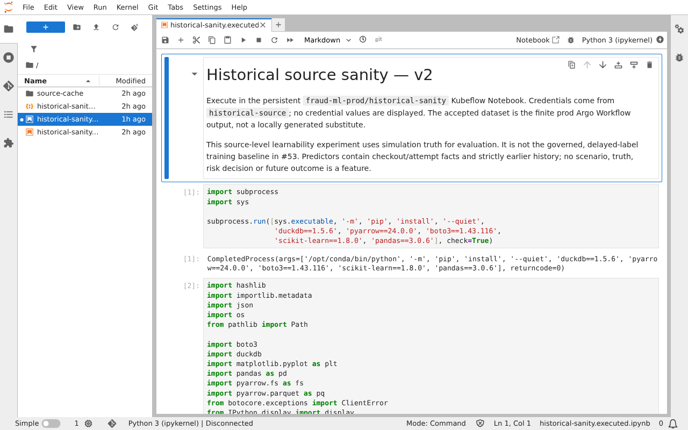
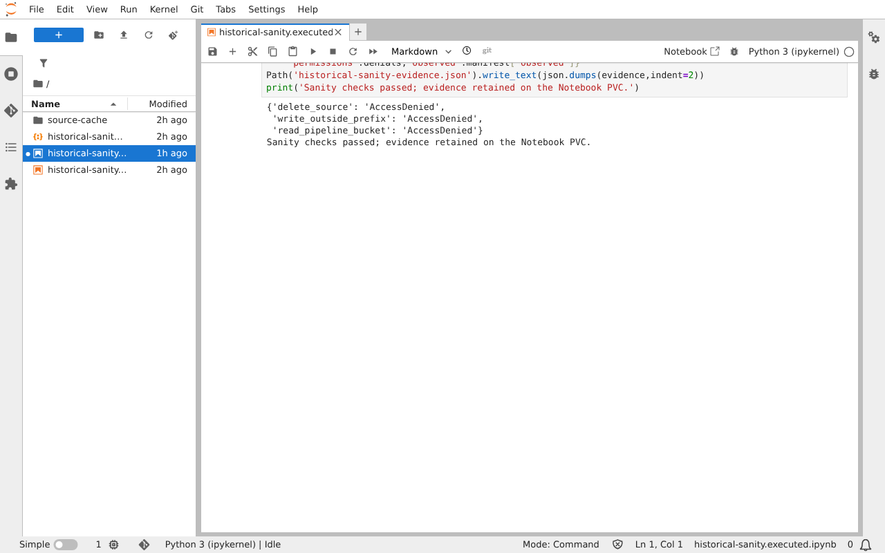
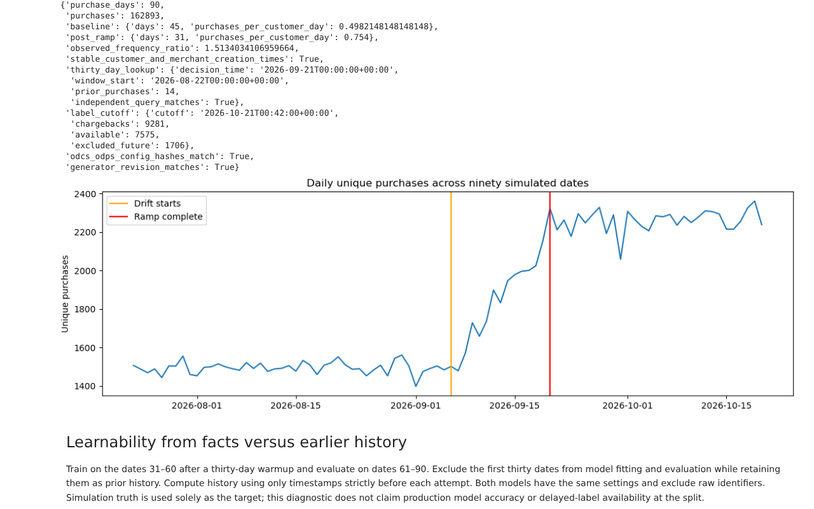

# Historical source verification

The source generator and its production integration are delivered by stacked [PR #75](https://github.com/phuchoang2603/realtime-credit-card-fraud-detection/pull/75) and [PR #76](https://github.com/phuchoang2603/realtime-credit-card-fraud-detection/pull/76), above the ODCS foundation in [PR #77](https://github.com/phuchoang2603/realtime-credit-card-fraud-detection/pull/77). Platform [PR #25](https://github.com/phuchoang2603/talos-proxmox/pull/25) extends the existing workflow controller watch list and enables the installed CNI for prod sidecar injection. Acceptance applies to the combined stack.

## Configuration and provenance

The [configuration](../../src/simulator/configs/historical-v1.yaml) selects dataset `v2`, seed `2603`, nine purchase dates starting `2026-10-12`, 3,000 customers, 40 merchants, and a physical schema cutover on `2026-10-16`. The filename is a configuration name; `dataset_version` controls publication. Customer category preferences are omitted; category skew belongs to merchants. Scenario activations now retain victims and contexts through reconstructable compromise windows.

The accepted output is `s3://synthetic-source/historical/v2/` at `https://minio.home.phuchoang.sbs`. It is immutable Parquet source outside bronze, separate from the pipeline artifact bucket and future Iceberg tables. A last-written `manifest.json` identifies a completed version; `validation.json` contains the native ODCS results.

The simulator image is `ghcr.io/phuchoang2603/realtime-credit-card-fraud-detection/simulator@sha256:e38d8ce5692a04de3011f672bedc52ab8bcad0fc9e4dab938f87a3ca788cecaf`, published by [run 39530678113](https://github.com/phuchoang2603/realtime-credit-card-fraud-detection/actions/runs/39530678113) from revision `dbee944`. The Notebook uses `ghcr.io/kubeflow/kubeflow/notebook-servers/jupyter-scipy@sha256:8f8a000b7eece82c7e874924dc45a3922e9197137eefe67f55c711cc3ce068fd` and installs pinned analysis dependencies recorded in its executed output.

## Observed results

Production Workflow [`historical-v2-vqccb`](historical-data/workflow.json), UID `f6322680-58ef-4ca4-acd5-0e88764dcc09`, succeeded on `2026-10-21` from `02:05:25Z` to `02:07:01Z`. Its generator container completed in 36 seconds. [Earlier failures](historical-data/attempts.json) remain recorded; they were not accepted datasets.

The [manifest](historical-data/manifest.json) SHA-256 is `5b45cbbafcc06b8e1cea23ff968cde8a219f9baa534afbedf7c9a0cae2b8cd3d`; configuration hash is `7d845714b0b162746c3afaaef696d037335058b7070fc14368ab1dbfd6cff160`. All 233 native checks passed in the [validation report](historical-data/validation.json). History ends at `2026-10-21T00:38:00Z`.

| Measurement | Observed |
| --- | --- |
| Delivered events / identical duplicates | 71,007 / 1,420 (1.9998%) |
| Purchases / chargebacks | 13,421 / 791 |
| Event files / label files | 10 / 30, all Zstandard |
| Event bytes / label bytes | 8,816,742 / 814,853 |
| Distinct customers / merchants | 2,967 / 40 |
| Distinct device / network fingerprints | 4,132 / 1,694 |
| Largest merchant share | 23.52% |
| Single-attempt AP / ROC-AUC | 0.4056 / 0.7543 |
| Earlier-history AP / ROC-AUC | 0.6435 / 0.8588 |
| AP improvement | 0.2379 |

The [machine-readable Notebook results](historical-data/sanity.json) include all eight fraud scenarios and the shared identity's three expected `AccessDenied` results. The temporal split trains on the first six purchase dates and evaluates the remaining dates. History improves average precision without making the single-attempt baseline near-perfect. Labels beyond the history end represent simulated delayed availability, not features available at decision time.

The [Notebook deployment capture](historical-data/notebook.json) records its pinned image, pod identity and bound 5 GiB PVC. Authenticated JupyterLab returned the executed output; an anonymous request returned HTTP 302 to sign-in. The PVC retains the executed notebook and source cache across Notebook recreation.

## Reproduction

Enter `devenv shell` in the combined stack. Reconcile the platform prerequisite, shared ClusterSecretStore, workspace and [historical generator chart](../../infra/charts/historical-generator/values.yaml). The only production workflow controller must watch `fraud-data-prod`; do not install another controller. Both namespace-local `historical-source` Secrets reference the same Doppler `prd` keys. Compare their contents in-process without printing credentials and check ExternalSecret readiness.

Use a new dataset version for a new accepted run. Submit the finite template:

```bash
kubectl --kubeconfig ~/.kube/talos-prod.yaml create -f - <<'YAML'
apiVersion: argoproj.io/v1alpha1
kind: Workflow
metadata:
  generateName: historical-source-
  namespace: fraud-data-prod
spec:
  workflowTemplateRef:
    name: historical-generator
YAML
kubectl --kubeconfig ~/.kube/talos-prod.yaml get workflows,pods -n fraud-data-prod
kubectl --kubeconfig ~/.kube/talos-prod.yaml logs -n fraud-data-prod <pod> -c main
```

The chart bounds concurrency, deadline, CPU, memory and temporary disk; the workflow service account can only create/patch executor task results. It restricts both the generator and injected Argo containers. S3 publication copies files directly, avoiding directory-marker writes that RustFS rejects under the prefix-scoped policy. The [immutable-version probe](historical-data/immutable-guard.txt), workflow `historical-v2-guard-d8qd2`, exited 2 because the version was already complete; a subsequent source read confirmed the same manifest SHA-256.

Open the Notebook through the authenticated [Kubeflow route](https://kubeflow.phuchoang.sbs/notebook/fraud-ml-prod/historical-sanity/lab). Its sidecar enforces the Profile's user-header authorization rules; prod Istio uses its existing CNI to avoid a privileged init container. No authentication bypass or public Notebook endpoint is used. Copy the versioned notebook into its persistent workspace and execute it there:

```bash
kubectl --kubeconfig ~/.kube/talos-prod.yaml cp \
  src/simulator/notebooks/historical-sanity.ipynb \
  fraud-ml-prod/historical-sanity-0:/home/jovyan/historical-sanity.ipynb -c historical-sanity
kubectl --kubeconfig ~/.kube/talos-prod.yaml exec -n fraud-ml-prod historical-sanity-0 -c historical-sanity -- \
  jupyter nbconvert --to notebook --execute /home/jovyan/historical-sanity.ipynb \
  --output historical-sanity.executed.ipynb --ExecutePreprocessor.timeout=600
```

The [executed notebook](../../src/simulator/notebooks/historical-sanity.ipynb) verifies physical rows and schema cutover, content-identical duplicates, skew, approximate fingerprint cardinalities, delayed labels and scenario rates. Both learnability models use the same classifier and checkout facts, including merchant category; history predictors use strictly earlier timestamps. Simulation truth is only the target. This source diagnostic does not satisfy the later governed features and delayed-label training acceptance in #53.



The capture shows the temporal holdout metrics and the passed history-improvement check inside the authenticated production Notebook.



The capture shows denied deletion, out-of-prefix writing and artifact-bucket access, followed by the successful sanity result.

## Access, failures and rotation

The [tracked source policy](../../infra/policies/synthetic-historical-writer.json) allows bucket listing and object read/write/multipart operations under `historical/*`, without deletion or artifact-bucket access. The generator and Notebook deliberately share that write-capable identity. Denial probes target a never-created source key, an out-of-prefix write and artifact-bucket listing; accepted objects are untouched.

Rotate the RustFS source key pair using operator credentials, update `HISTORICAL_RUSTFS_ACCESS_KEY` and `HISTORICAL_RUSTFS_SECRET_KEY` together in Doppler project `realtime-credit-card-fraud-detection`, config `prd`, wait for both ExternalSecrets to refresh, and restart the Notebook and future workflow pods because environment variables do not refresh in existing processes. Verify scoped read/write before revoking the old key. Rotate `ESO_DOPPLER_TOKEN` by replacing `fraud-ml-prod/fraud-doppler-token` key `dopplerToken`, then verify ClusterSecretStore and existing artifact/database secrets remain Ready. Never commit or display key values.

A version without a manifest is incomplete and must not be consumed. The CLI refuses nonempty incomplete prefixes too. Inspect workflow logs and the prefix, then choose a new version or use elevated operator credentials for deliberate cleanup; the source identity cannot delete. Never remove or overwrite an accepted manifest to retry. Record failed attempts alongside successful evidence.

The production root Applications were temporarily switched to the feature branches for this verification. [Restoration verification](historical-data/restoration.json) confirms both original specs are restored, both roots are Healthy/Synced on `main`, and no Application tracks either temporary branch. The temporary Notebook, historical generator Application and data namespace were removed. The bound workspace PVC and immutable external dataset remain. Its Argo tracking annotation was removed so the retained workspace does not keep the existing workspace Application out of sync. Git contains the accepted notebook and evidence; redeploy the merged stack to reopen the retained PVC.

## Local 90-day extension

[PR #78](https://github.com/phuchoang2603/realtime-credit-card-fraud-detection/pull/78) adds the separate [90-day preset](../../src/simulator/configs/historical-90d.yaml), optional abrupt/gradual purchase-frequency drift, fixed entity creation timestamps and [ODPS product metadata](../../contracts/products/historical-payments.odps.yaml) referencing the unchanged ODCS agreement. The [extension report](historical-data/history-extension.json) and [local manifest](historical-data/history-extension-manifest.json) identify this generator revision, configuration and both descriptors. This section records local CLI verification; the [production extension verification](#production-90-day-extension) below records the later Workflow/Notebook run. Both remain separate from #53 training acceptance.

Enter `devenv shell` and select a fresh local output directory:

```bash
cd src/simulator
uv run --locked python -m simulator.cli \
  --config configs/historical-90d.yaml --output /tmp/historical-drift
```

The generated `historical/v3-history90/manifest.json` records daily unique purchase counts for all ninety UTC dates, including empty days. Compare counts per customer-day before `2026-09-06` with the post-ramp period from `2026-09-20`; exclude the intervening ramp. The configured rates are 0.5 and 0.75 purchases per customer-day. Native `validation.json` records publication-gating ODCS results. The [native report](historical-data/history-extension-validation.json) contains 233 passing checks. The completed local run generated 162,893 purchases and 862,503 delivered payment events, including 17,250 identical duplicates, in 112,566,110 Parquet bytes. Generation took 162.6 seconds with peak child RSS of about 1.44 GiB on this workstation; these are local measurements, not cluster capacity guarantees. Observed frequency was 0.4982 before drift and 0.7540 after the ramp, a 1.5134 ratio. A checked thirty-day window contained fourteen strictly earlier purchases; the history-end label cutoff admitted 7,575 chargebacks and excluded 1,706 future labels.

Independent DuckDB reads use `TimeZone=UTC`, deduplicate creation events, and compare daily counts with the manifest. A strictly earlier thirty-day window is checked against an independent timestamp-range query; repeated snapshots retain one creation timestamp per customer and merchant. Chargebacks with `label_available_at > history_end` are excluded from the cutoff read. These checks establish source availability and consumption semantics; DP3 still owns feature tables, and #53 owns delayed-label training.

Small runtime probes reject thirteen invalid drift configurations before output, preserve independently reconstructed seeded days and the previous scheduler when drift is omitted, reproduce nineteen byte-identical Parquet files, and retain six zero-purchase dates. An initial diagnostic inherited the workstation's `US/Eastern` timezone and failed the UTC daily-count comparison. Generator sort/validation sessions and these reader checks now set UTC explicitly. Interrupted attempts that produced no completed manifest are not accepted runs.


## Production 90-day extension

Production Workflow [`historical-v3-history90-lzfzb`](historical-data/history90/workflow.json), UID `c75a8217-9ff7-46e3-807f-efa09c9ee5a0`, succeeded on `2026-10-21` from `14:04:41Z` to `14:08:52Z`. Its generator container ran for 206 seconds on `prod-server1`, within the existing two-CPU and 2 GiB limits. [Image publication run 39612396428](https://github.com/phuchoang2603/realtime-credit-card-fraud-detection/actions/runs/39612396428) built revision `f805bc3`; the deployed image is `ghcr.io/phuchoang2603/realtime-credit-card-fraud-detection/simulator@sha256:e65c52bf8fdb9154f918b1abc42ed0fcd1d77959f933b264b58e9108b3ad2447`.

The accepted output is `s3://synthetic-source/historical/v3-history90/`. Its [manifest](historical-data/history90/manifest.json) SHA-256 is `2c5b8636b0393319d1675deab65320bdfdb545c72024252c5117d61c8c2c7a09`; all 233 checks passed in the [native ODCS report](historical-data/history90/validation.json). It contains 162,893 purchases across ninety dates and 862,503 delivered events, including 17,250 identical duplicates, in 112,566,110 Parquet bytes. All 202 Parquet files are [byte-identical to the independently generated local reference](historical-data/history90/parquet-comparison.json). The manifest differs because the output destination is S3.

The [executed production notebook](../../src/simulator/notebooks/historical-90d-sanity.ipynb) and [machine-readable sanity results](historical-data/history90/sanity.json) verify physical schema cutover, partitions, duplicates, all scenarios, skew, stable entity creation times and exact ODCS/ODPS/configuration provenance. Baseline frequency is 0.4982 purchases/customer/day and post-ramp frequency is 0.7540, a 1.5134 ratio. An independently checked thirty-day window contains fourteen strictly earlier purchases. The history-end cutoff admits 7,575 chargebacks and excludes 1,706 future labels. After excluding the first thirty dates as warmup, the source diagnostic trains on dates 31–60 and evaluates dates 61–90: average precision improves from 0.4328 to 0.8303 using strictly earlier history. Simulation truth remains a diagnostic target; this does not accept DP3 features or #53 delayed-label training.



The capture shows the executed output served through the authenticated prod Notebook route, including the measured drift and label cutoff. Authenticated Notebook contents returned HTTP 200; an anonymous request redirected to sign-in. Source deletion, out-of-prefix writing and pipeline-bucket access were denied. The [verification report](historical-data/history90/verification.json) records the pinned Notebook image, retained workspace, descriptor identities and failed diagnostic attempts. The first Notebook attempt compared raw YAML bytes with a canonical JSON configuration hash; the second encountered DuckDB's optional `pytz` dependency when fetching a timezone-aware Python timestamp. The accepted rerun checks both hash forms separately and parses the sample timestamp from ISO text with the standard library. No source data was regenerated for these diagnostic fixes.

The WorkflowTemplate accepts a `config` argument; its default remains the nine-day preset. To reproduce the longer run, use the submission above with this added `spec.arguments` block after selecting a fresh dataset version:

```yaml
arguments:
  parameters:
    - name: config
      value: /app/src/simulator/configs/historical-90d.yaml
```

Copy `historical-90d-sanity.ipynb` and the versioned ODCS, ODPS and preset files into the Notebook workspace; the notebook expects the three files under `history90-descriptors/`. Execute it with `jupyter nbconvert --to notebook --execute historical-90d-sanity.ipynb --output historical-90d-sanity.executed.ipynb --ExecutePreprocessor.timeout=1200`.

The [immutable-version guard](historical-data/history90/immutable-guard-workflow.json), workflow `historical-v3-history90-guard-sw7xj`, exited 2 with [the expected refusal](historical-data/history90/immutable-guard.log). A subsequent read confirmed the same manifest hash. A transient `prod-server2` NotReady interval delayed Argo reconciliation before submission; the node recovered before the source workflow began. [Restoration evidence](historical-data/history90/restoration.json) records both original root specs restored on `main`, temporary generator/Notebook resources removed, and the immutable dataset and bound workspace retained.
